<p align="center">
  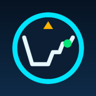
</p>

<h1 align="center">Extreme DECO Planner</h1>

<p align="center">
  <strong>A technical scuba diving decompression planner for Android and Apple, iOS.</strong><br>
  Bühlmann ZHL-16A / B / C with Gradient Factors, Best Gas Mix selection, CCR with bailout, multi-dive days, interactive charts and PDF / CSV export. Everything runs on the phone, offline.
</p>

<p align="center">
  <a href="https://github.com/RamyRedaM/Extreme-DECO-Planner-Android-Mobile-APP/releases/download/v1.27.2/Extreme-DECO-Planner-v1.27.2.apk"><strong>⬇ Android Mobiles Download (APK) Ver 1.27.2</strong></a>
  &nbsp;·&nbsp;
  <a href="https://github.com/RamyRedaM/Extreme-DECO-Planner-Android-Mobile-APP/releases/download/v1.27.2/Extreme-DECO-Planner-v1.27.2-unsigned.ipa"><strong>⬇ iPhone Mobiles Download (ipa , sideloadly) Ver 1.27.2</strong></a>
</p>

<p align="center">
  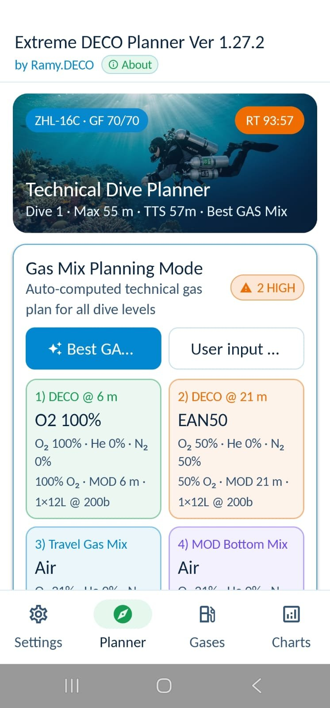
  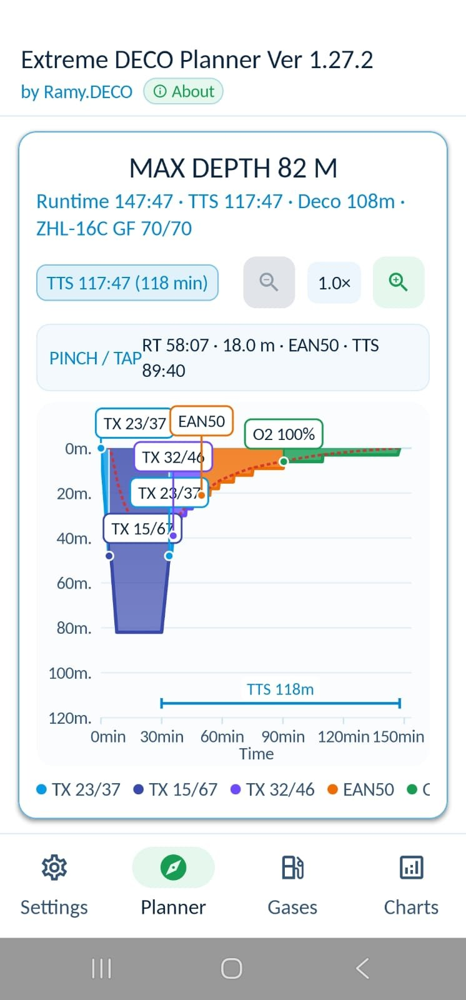
  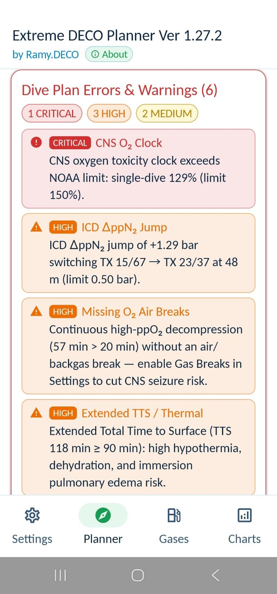
  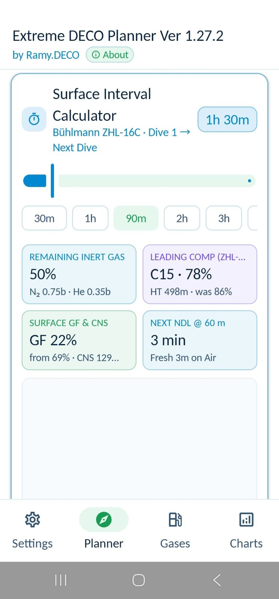
</p>

<p align="center">
  
  
  
  
  
  <a href="LICENSE"></a>
  
  
  
  <a href="https://github.com/RamyRedaM/Extreme-DECO-Planner-Android-Mobile-APP/actions/workflows/build-apk.yml"></a>
  <a href="https://github.com/RamyRedaM/Extreme-DECO-Planner-Android-Mobile-APP/actions/workflows/build-ios.yml"></a>
</p>

---

> [!WARNING]
> **There is always a risk of decompression sickness (DCS), oxygen toxicity and other injury on any dive, even when you follow a plan produced by this app.** Every experienced TEC diver knows that all decompression algorithms are calibrated by trial and error, and that NO mathematical model on earth can truly and 100% model the human body and how it will react to different depths with different gases. So Extreme DECO Planner is for training and planning only. It does not replace technical diver training, certification, a dive computer or your own judgement. Dive within your training limits, cross-check every plan with a second independent planner, and carry backup tables. You use this software at your own risk.

---

## Why Expert Divers Can Trust the Numbers

| | |
|---|---|
| 🔬 **Published science only** | Bühlmann ZHL-16A / B / C, Baker's Gradient Factors, NOAA oxygen limits, Lambertsen's OTU, Anthony & Mitchell's gas density limits, Doolette & Mitchell's ICD work. Every formula is written out in [The Science Behind the Planner](#the-science-behind-the-planner), with its source. |
| 📖 **Open source (GPL-3.0)** | The whole calculation engine is in this repository, in plain Kotlin and Swift with no hidden server. Anyone can read how a stop, a CNS value or a gas volume is calculated. |
| 🔁 **Two independent implementations** | The Android engine (Kotlin) and the iPhone engine (Swift) are separate code bases. On every build they must give the same stops, runtime, CNS, OTU, gas volumes and alerts on 16 reference dives, or the build fails. |
| ✅ **About 100 automated tests** | Golden decompression schedules, physics checks (Haldane, Schreiner, GF, MOD, END, density), CNS and OTU, CCR bailout, multi-dive days, and gas selection for every diving agency option. They run on every build. |
| ⚠️ **Honest limits** | What the app does not do is written down: VPM-B is approximate and marked experimental, Bühlmann does not model bubbles, and every plan must be cross-checked with a second planner. See [Known Limitations](#known-limitations). |

---

## Table of Contents

- [Why Expert Divers Can Trust the Numbers](#why-expert-divers-can-trust-the-numbers)
- [Overview](#overview)
- [Download](#download)
- [iPhone (iOS)](#iphone-ios)
- [Features](#features)
- [App Screens](#app-screens)
- [Screenshots](#screenshots)
- [How to Plan a Dive](#how-to-plan-a-dive)
- [The Science Behind the Planner](#the-science-behind-the-planner)
- [Best Gas Mix](#best-gas-mix)
- [Surface Interval Calculator](#surface-interval-calculator)
- [Safety Alerts](#safety-alerts)
- [Build from Source](#build-from-source)
- [Tech Stack](#tech-stack)
- [Project Structure](#project-structure)
- [Verification](#verification)
- [Default Settings](#default-settings)
- [Known Limitations](#known-limitations)
- [Roadmap](#roadmap)
- [Contributing](#contributing)
- [References](#references)
- [Contact](#contact)
- [License](#license)

---

## Overview

Extreme DECO Planner helps technical divers plan open circuit and closed circuit (CCR) decompression dives on an Android phone or an iPhone. You set the depth, bottom time, gases and your limits, and the app:

1. Recommends the **best bottom, travel and deco gases** for the depth, with cylinder sizes.
2. Builds a full **decompression schedule** with the model you choose.
3. Reports **runtime, stops, CNS %, OTU, END, gas density and gas volumes**.
4. Draws **charts** of the profile, partial pressures, tissue loading and gas use.
5. Plans **multi-dive days**, carrying residual nitrogen and helium from dive to dive.
6. Generates **contingency plans** and a **CCR bailout** plan.
7. Exports the plan as a **PDF dive slate** or **CSV**, ready to share.

No account, no server and no internet connection are needed. Your settings and saved plans stay on your device.

---

## Download

**Latest test build: [Extreme-DECO-Planner-v1.27.2.apk](https://github.com/RamyRedaM/Extreme-DECO-Planner-Android-Mobile-APP/releases/download/v1.27.2/Extreme-DECO-Planner-v1.27.2.apk)** (about 18 MB, Android 7.0 or later)

All versions and release notes are on the [Releases page](https://github.com/RamyRedaM/Extreme-DECO-Planner-Android-Mobile-APP/releases). A Google Play release will follow later.

### How to install

1. Open the download link on your Android phone and download the APK.
2. Tap the downloaded file. When Android asks, allow **Install unknown apps** for your browser or file manager, then tap **Install**.
3. If Google Play Protect warns that the app is unknown, tap **Install anyway**. This is normal for apps installed outside Google Play.

> [!NOTE]
> This is a **test build** signed with a temporary debug key. A later build signed with a different key cannot install over it as an update: uninstall the old version first. Your saved plans are removed when you uninstall.

You can also [build the app from source](#build-from-source).

---

## iPhone (iOS)

The iPhone version is a native SwiftUI app in [`ios/`](ios/), with the same four tabs and features as Android. It is a separate code base: the Swift engine is a line-by-line port of the Kotlin engine, and parity tests check on every build that both engines give the same schedules, CNS, OTU, gas figures and alerts. See [Verification](#verification) for how the two code bases are kept in step.

**Test build: [Extreme-DECO-Planner-v1.27.2-unsigned.ipa](https://github.com/RamyRedaM/Extreme-DECO-Planner-Android-Mobile-APP/releases/download/v1.27.2/Extreme-DECO-Planner-v1.27.2-unsigned.ipa)** (iOS 16 or later)

Apple only runs signed apps, so the .ipa has to be signed with your own Apple ID when you install it:

1. Install [Sideloadly](https://sideloadly.io) or [AltStore](https://altstore.io) on a Windows PC or Mac.
2. Connect the iPhone by cable, drop the .ipa into the tool and sign in with your Apple ID.
3. On the iPhone, open **Settings → General → VPN & Device Management** and trust your Apple ID, then turn on **Settings → Privacy & Security → Developer Mode**.

With a free Apple ID the app must be re-signed every 7 days. A TestFlight link (no sideloading, needs an Apple Developer account) will follow.

---

## Features

### Planning
- **Open Circuit** and **CCR** planning (setpoint-based), with automatic CCR bailout to open circuit
- **Multi-level dives** (add levels) and **multi-dive days** (add dives with surface intervals), with residual N2 / He carried across dives and a daily OTU total
- Two gas modes: **Best GAS Mix** (the app picks the gases) or **User input GAS** (you enter them)
- **Recreational (REC) mode, automatic:** in Best GAS Mix mode, a dive shallower than 40 m that stays within the no-decompression limit is planned as a recreational dive on Air or Nitrox (EAN32 by default), with no trimix and no deco gases. Deeper or longer dives switch to full technical planning.
- Travel, bottom, diluent, deco and bailout gas roles
- Automatic gas switching during the ascent
- Configurable descent, ascent, deco ascent and final ascent rates
- Last stop at 3 m or 6 m, detailed or compact (stops only) plan style
- Gas breaks on high-oxygen deco
- Water salinity: Fresh, EN13319, Salt, Red Sea (editable from 1020 to 1040 kg/m³) or custom density
- Dive site altitude, with an option for divers who arrived at altitude less than 12 hours ago
- Metric (m / L / bar / °C) or Imperial (ft / cuft / psi / °F) units

### Decompression
- **Bühlmann ZHL-16A, ZHL-16B and ZHL-16C** (ZHL-16C recommended)
- **Gradient Factors** (GF Low / GF High)
- Haldane loading at constant depth, Schreiner loading during ascents and descents
- **GF99** and **Surface GF** read-outs, no-decompression limit (NDL) and time to surface
- **VPM-B (experimental)** with conservatism 0 to 5. See [Known Limitations](#known-limitations).

### Gas management
- MOD, minimum (hypoxic) depth, END, EAD, PPN2 and gas density for every gas
- Gas consumption per segment from bottom and deco RMV
- Bottom gas reserve rules: Thirds, Quarters, Half, or Rock-Bottom (2× stress)
- Deco gas reserve rules: 1.5× required, or a real **lost-gas scenario** (the dive is replanned with each deco gas lost in turn, and every deco gas carries its worst-case need × the stress factor)
- Rock-bottom reserve for the bottom gas: two divers at stress breathing rate, from max depth to the first gas switch on the ascent
- Cylinder sizes and counts, auto-sized from your SAC rate in Best GAS Mix mode

### Surface intervals
- **Surface Interval Calculator** on the Planner tab, using Bühlmann ZHL-16C: remaining nitrogen and helium in all 16 tissue compartments, leading compartment, Surface GF, CNS decay, time to clear 90% of the excess gas, and the NDL for your next dive. See [Surface Interval Calculator](#surface-interval-calculator).

### Oxygen and safety
- CNS % from the NOAA oxygen limits, with surface decay between dives
- Pulmonary OTU per dive and per day
- **Safety alerts in four colour-coded levels:** CRITICAL (red), HIGH (orange), MEDIUM (yellow) and LOW (gray), covering more than 30 checks. See [Safety Alerts](#safety-alerts).
- A severity summary at the top of the alerts list, and a status pill that shows **PLAN READY** or the highest alert level

### Output
- Runtime table with depth, time, runtime, mix and ppO2
- Six charts: dive profile, gas partial pressures, tissue compartment bars, tissue tension timeline, gas consumption, and an M-value diagram
- **Export PDF Slate** (two-page dive slate and technical report) and **Export CSV Data**, saved to your phone or shared from the app
- Save named plans, and the app reopens with your last plan
- Dark and light themes
- Safety disclaimer that must be accepted on first launch

---

## App Screens

The app has four tabs:

| Tab | What you do there |
|---|---|
| **Settings** | Planning type, units, deco model, diving agency for Best GAS Mix, gradient factors, salinity, altitude, PPO2 and narcosis limits, ascent and descent rates, RMV, reserve rules, CCR setpoints, theme |
| **Planner** | Dive levels and dives in the day, Build Dive Profile, runtime table, summary (runtime, CNS, OTU, gas), colour-coded safety alerts, contingency plans, Surface Interval Calculator, PDF / CSV export, saved plans |
| **Gases** | Recommend Best Mix, or add and edit your own travel, bottom, diluent, deco and bailout gases with cylinders |
| **Charts** | Profile, partial pressures, tissue loading, gas consumption and M-value charts |

See the [Screenshots](#screenshots) section for every screen.

---

## Screenshots

Screenshots from the Android app, version 1.27.2. The iPhone app has the same four tabs and features.

### Planner

Plan the dive, read the schedule, check the alerts.

<table>
  <tr>
    <td align="center" valign="top" width="25%"><a href="https://raw.githubusercontent.com/RamyRedaM/Extreme-DECO-Planner-Android-Mobile-APP/main/docs/screenshots/v1.27.2/planner-overview.jpg"></a><br><sub>Technical dive plan with Best GAS Mix</sub></td>
    <td align="center" valign="top" width="25%"><a href="https://raw.githubusercontent.com/RamyRedaM/Extreme-DECO-Planner-Android-Mobile-APP/main/docs/screenshots/v1.27.2/planner-dive-levels.jpg"></a><br><sub>Dive profile input and plan summary</sub></td>
    <td align="center" valign="top" width="25%"><a href="https://raw.githubusercontent.com/RamyRedaM/Extreme-DECO-Planner-Android-Mobile-APP/main/docs/screenshots/v1.27.2/planner-profile-chart.jpg"></a><br><sub>Dive profile chart with gas switches and TTS</sub></td>
    <td align="center" valign="top" width="25%"><a href="https://raw.githubusercontent.com/RamyRedaM/Extreme-DECO-Planner-Android-Mobile-APP/main/docs/screenshots/v1.27.2/planner-runtime-table.jpg">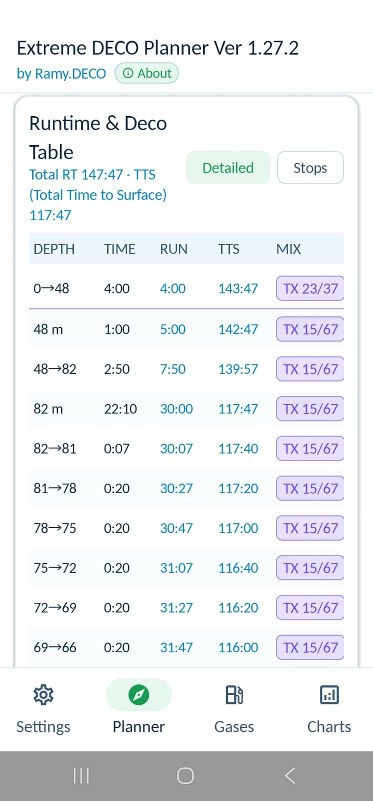</a><br><sub>Runtime and deco table</sub></td>
  </tr>
  <tr>
    <td align="center" valign="top" width="25%"><a href="https://raw.githubusercontent.com/RamyRedaM/Extreme-DECO-Planner-Android-Mobile-APP/main/docs/screenshots/v1.27.2/planner-runtime-gases.jpg">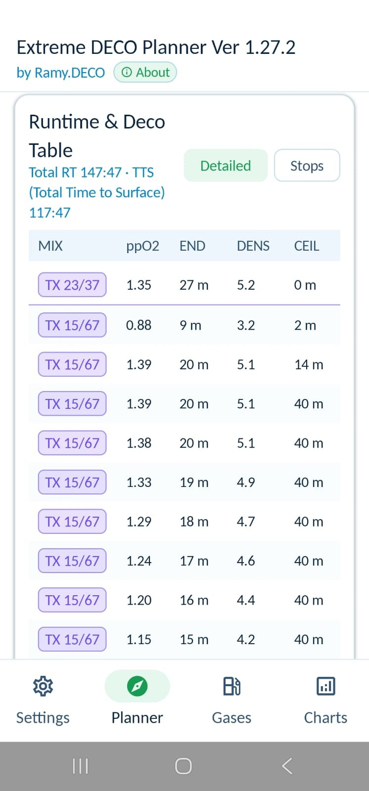</a><br><sub>Per segment: ppO2, END, density, ceiling</sub></td>
    <td align="center" valign="top" width="25%"><a href="https://raw.githubusercontent.com/RamyRedaM/Extreme-DECO-Planner-Android-Mobile-APP/main/docs/screenshots/v1.27.2/planner-best-gas-kit.jpg">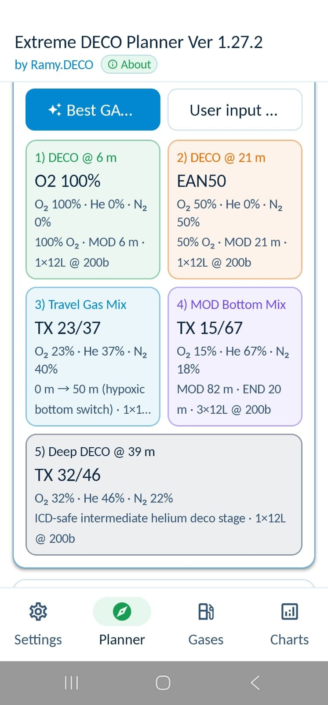</a><br><sub>Best GAS Mix: trimix kit with deep deco stage (82 m)</sub></td>
    <td align="center" valign="top" width="25%"><a href="https://raw.githubusercontent.com/RamyRedaM/Extreme-DECO-Planner-Android-Mobile-APP/main/docs/screenshots/v1.27.2/planner-best-gas-tdi.jpg">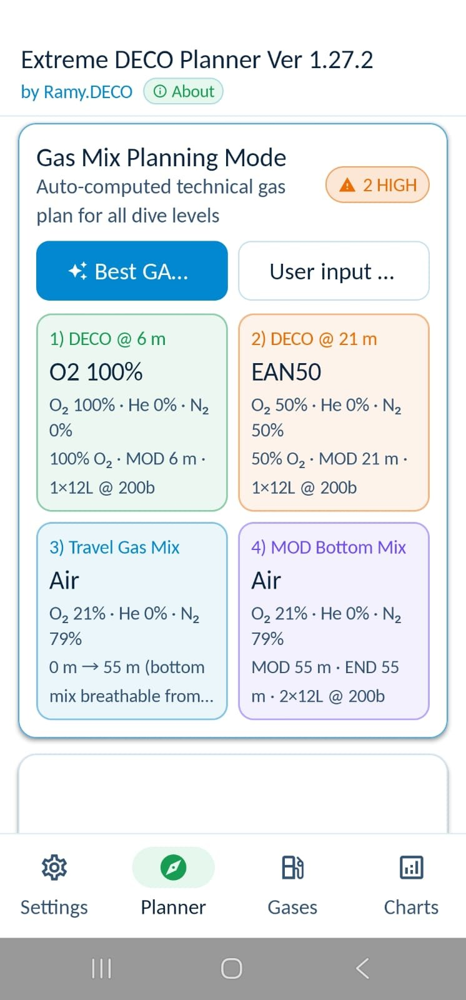</a><br><sub>Best GAS Mix, TDI method: air bottom gas</sub></td>
    <td align="center" valign="top" width="25%"><a href="https://raw.githubusercontent.com/RamyRedaM/Extreme-DECO-Planner-Android-Mobile-APP/main/docs/screenshots/v1.27.2/planner-alerts.jpg"></a><br><sub>Safety alerts: Critical, High, Medium</sub></td>
  </tr>
  <tr>
    <td align="center" valign="top" width="25%"><a href="https://raw.githubusercontent.com/RamyRedaM/Extreme-DECO-Planner-Android-Mobile-APP/main/docs/screenshots/v1.27.2/planner-surface-interval.jpg"></a><br><sub>Surface Interval Calculator (ZHL-16C)</sub></td>
    <td align="center" valign="top" width="25%"><a href="https://raw.githubusercontent.com/RamyRedaM/Extreme-DECO-Planner-Android-Mobile-APP/main/docs/screenshots/v1.27.2/planner-offgassing.jpg">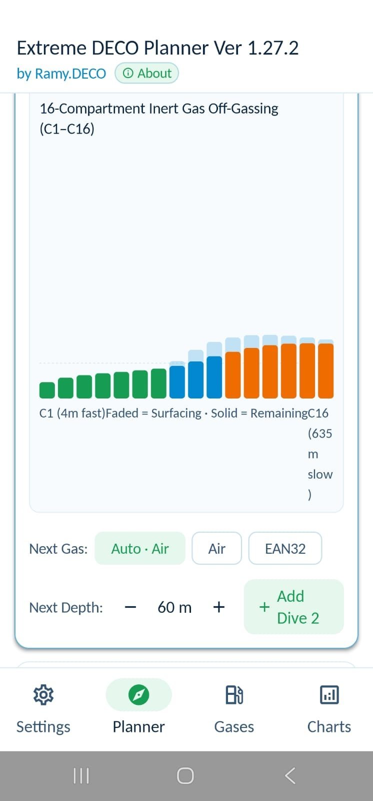</a><br><sub>Surface off-gassing of C1 to C16</sub></td>
    <td align="center" valign="top" width="25%"><a href="https://raw.githubusercontent.com/RamyRedaM/Extreme-DECO-Planner-Android-Mobile-APP/main/docs/screenshots/v1.27.2/planner-contingency-export.jpg">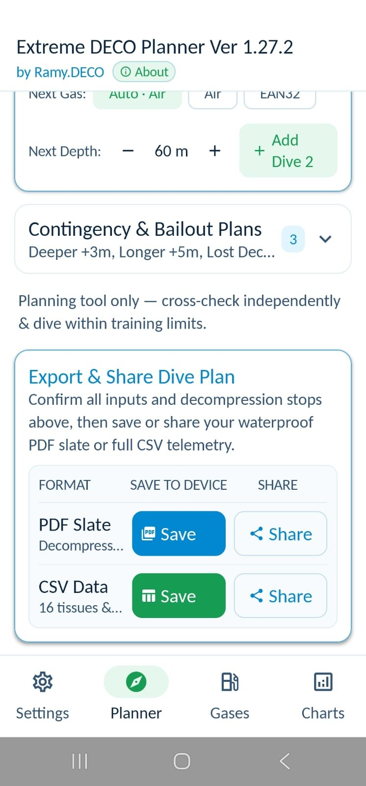</a><br><sub>Contingency plans and PDF / CSV export</sub></td>
  </tr>
</table>

### Gases

Every cylinder with its MOD, minimum depth, END and density.

<table>
  <tr>
    <td align="center" valign="top" width="25%"><a href="https://raw.githubusercontent.com/RamyRedaM/Extreme-DECO-Planner-Android-Mobile-APP/main/docs/screenshots/v1.27.2/gases-kit.jpg">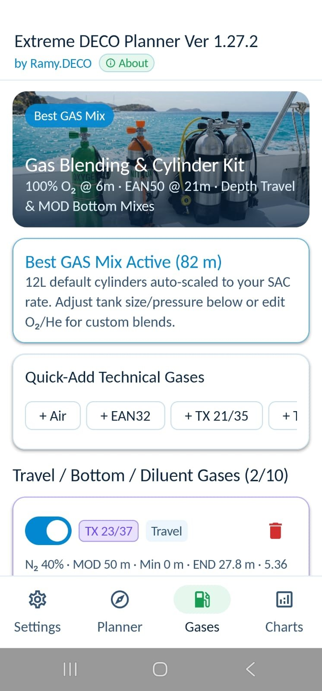</a><br><sub>Gas blending and cylinder kit</sub></td>
    <td align="center" valign="top" width="25%"><a href="https://raw.githubusercontent.com/RamyRedaM/Extreme-DECO-Planner-Android-Mobile-APP/main/docs/screenshots/v1.27.2/gases-editor.jpg"></a><br><sub>Travel / bottom gas editor</sub></td>
    <td align="center" valign="top" width="25%"><a href="https://raw.githubusercontent.com/RamyRedaM/Extreme-DECO-Planner-Android-Mobile-APP/main/docs/screenshots/v1.27.2/gases-deco-bailout.jpg">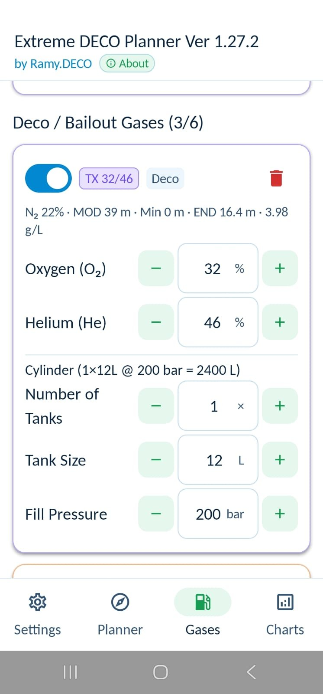</a><br><sub>Deep deco / bailout stage</sub></td>
    <td align="center" valign="top" width="25%"><a href="https://raw.githubusercontent.com/RamyRedaM/Extreme-DECO-Planner-Android-Mobile-APP/main/docs/screenshots/v1.27.2/gases-deco-editor.jpg">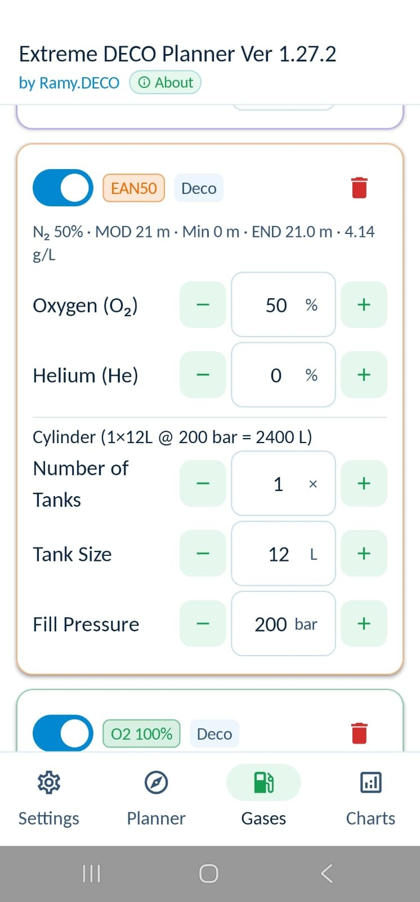</a><br><sub>EAN50 and oxygen deco cylinders</sub></td>
  </tr>
</table>

### Charts

Tissue loading, partial pressures, M-value envelope and gas use.

<table>
  <tr>
    <td align="center" valign="top" width="25%"><a href="https://raw.githubusercontent.com/RamyRedaM/Extreme-DECO-Planner-Android-Mobile-APP/main/docs/screenshots/v1.27.2/charts-overview.jpg"></a><br><sub>Decompression and tissue charts</sub></td>
    <td align="center" valign="top" width="25%"><a href="https://raw.githubusercontent.com/RamyRedaM/Extreme-DECO-Planner-Android-Mobile-APP/main/docs/screenshots/v1.27.2/charts-16-compartments.jpg">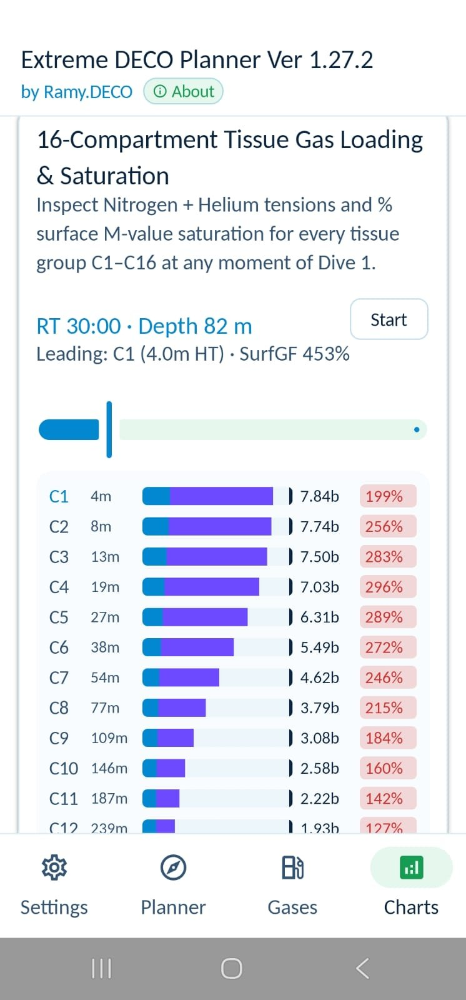</a><br><sub>16-compartment tissue loading and saturation</sub></td>
    <td align="center" valign="top" width="25%"><a href="https://raw.githubusercontent.com/RamyRedaM/Extreme-DECO-Planner-Android-Mobile-APP/main/docs/screenshots/v1.27.2/charts-partial-pressures.jpg">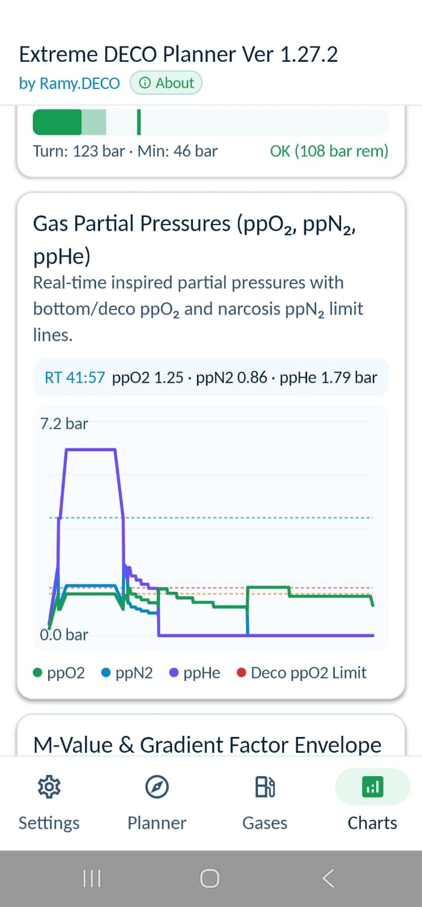</a><br><sub>Gas partial pressures (ppO2, ppN2, ppHe)</sub></td>
    <td align="center" valign="top" width="25%"><a href="https://raw.githubusercontent.com/RamyRedaM/Extreme-DECO-Planner-Android-Mobile-APP/main/docs/screenshots/v1.27.2/charts-tension-timeline.jpg">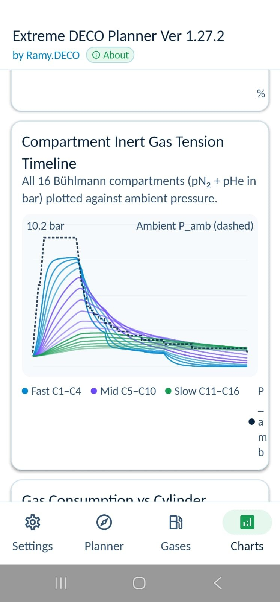</a><br><sub>Inert gas tension timeline, C1 to C16</sub></td>
  </tr>
  <tr>
    <td align="center" valign="top" width="25%"><a href="https://raw.githubusercontent.com/RamyRedaM/Extreme-DECO-Planner-Android-Mobile-APP/main/docs/screenshots/v1.27.2/charts-gas-consumption.jpg">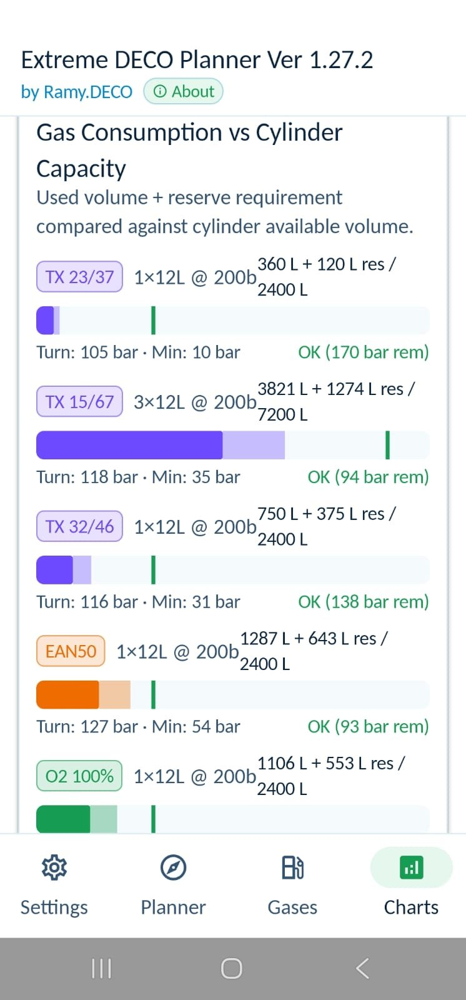</a><br><sub>Gas consumption vs cylinder capacity</sub></td>
  </tr>
</table>

### Settings

Model, diving agency, limits, rates, reserves and alert thresholds.

<table>
  <tr>
    <td align="center" valign="top" width="25%"><a href="https://raw.githubusercontent.com/RamyRedaM/Extreme-DECO-Planner-Android-Mobile-APP/main/docs/screenshots/v1.27.2/settings-overview.jpg">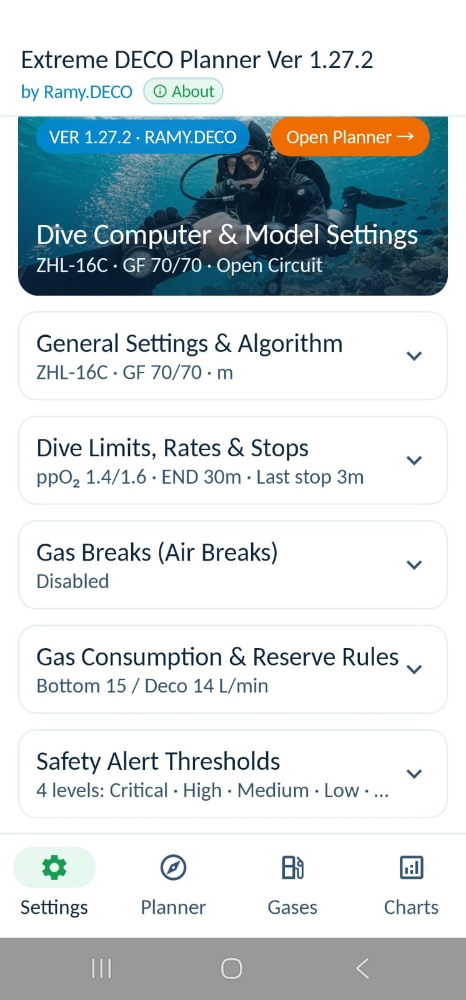</a><br><sub>Dive computer and model settings</sub></td>
    <td align="center" valign="top" width="25%"><a href="https://raw.githubusercontent.com/RamyRedaM/Extreme-DECO-Planner-Android-Mobile-APP/main/docs/screenshots/v1.27.2/settings-general.jpg">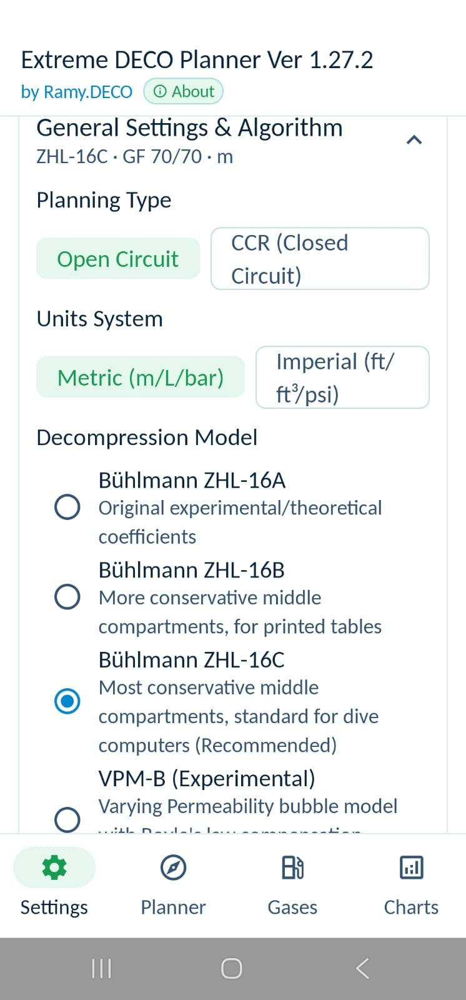</a><br><sub>Planning type, units and deco model</sub></td>
    <td align="center" valign="top" width="25%"><a href="https://raw.githubusercontent.com/RamyRedaM/Extreme-DECO-Planner-Android-Mobile-APP/main/docs/screenshots/v1.27.2/settings-model-gf.jpg">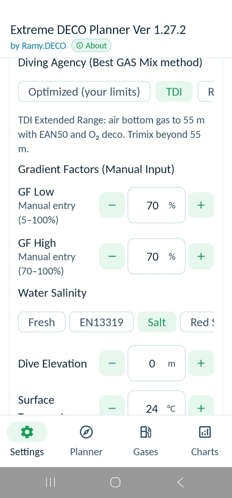</a><br><sub>Diving agency, gradient factors and water</sub></td>
    <td align="center" valign="top" width="25%"><a href="https://raw.githubusercontent.com/RamyRedaM/Extreme-DECO-Planner-Android-Mobile-APP/main/docs/screenshots/v1.27.2/settings-limits.jpg">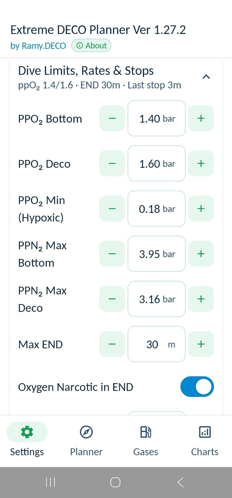</a><br><sub>ppO2, ppN2 and END limits</sub></td>
  </tr>
  <tr>
    <td align="center" valign="top" width="25%"><a href="https://raw.githubusercontent.com/RamyRedaM/Extreme-DECO-Planner-Android-Mobile-APP/main/docs/screenshots/v1.27.2/settings-rates.jpg"></a><br><sub>Gas density, rates and stops</sub></td>
    <td align="center" valign="top" width="25%"><a href="https://raw.githubusercontent.com/RamyRedaM/Extreme-DECO-Planner-Android-Mobile-APP/main/docs/screenshots/v1.27.2/settings-gas-reserve.jpg">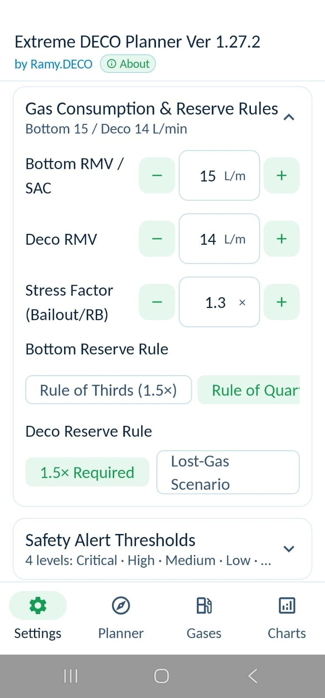</a><br><sub>Gas consumption and reserve rules</sub></td>
    <td align="center" valign="top" width="25%"><a href="https://raw.githubusercontent.com/RamyRedaM/Extreme-DECO-Planner-Android-Mobile-APP/main/docs/screenshots/v1.27.2/settings-icd-budgets.jpg">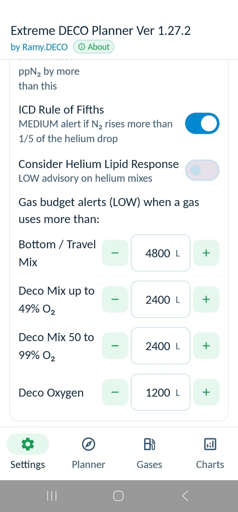</a><br><sub>ICD rules and gas budget alerts</sub></td>
    <td align="center" valign="top" width="25%"><a href="https://raw.githubusercontent.com/RamyRedaM/Extreme-DECO-Planner-Android-Mobile-APP/main/docs/screenshots/v1.27.2/settings-alert-thresholds.jpg">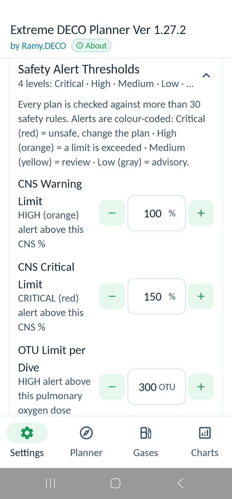</a><br><sub>CNS and OTU alert thresholds</sub></td>
  </tr>
</table>

---

## How to Plan a Dive

1. **Settings:** choose Open Circuit or CCR, your units, the deco model (ZHL-16C recommended) and your gradient factors. Set the salinity and altitude of the dive site.
2. **Planner:** enter the maximum depth and bottom time. Add levels for a multi-level dive, or add dives for a dive day.
3. **Gases:** tap **Recommend Best Mix**, or enter your own gases and cylinders.
4. **Planner:** tap **Build Dive Profile**. Read the runtime table and summary, then work through the safety alerts: fix every **CRITICAL** (red) alert, and review **HIGH** (orange) and **MEDIUM** (yellow) ones.
5. **Repetitive dive?** Use the **Surface Interval Calculator** to see how much gas your tissues still hold and your NDL for the next dive, then tap **Apply** or **Add Dive 2** to carry the interval into the dive day.
6. **Charts:** check the profile, ppO2 and tissue loading.
7. **Export** the PDF slate, and cross-check the plan with a second planner before you dive.

### Example

40 m for 20 min on air (2 × 12 L), ZHL-16C, GF 20/80, salt water, deco on EAN50 and oxygen. This is reference dive S1 of the test suite, so these are the exact numbers both apps produce:

| Depth (m) | Stop (min) | Gas | Note |
|---|---|---|---|
| 21 | 1 | EAN50 | Gas switch |
| 9 | 2 | EAN50 | |
| 6 | 2 | Oxygen | Gas switch |
| 3 | 3 | Oxygen | |

Runtime 33 min, 8 min of deco, end CNS 19%, 38 OTU, Surface GF 75%. Gas use: air 3108 L of 4800 L, EAN50 266 L, oxygen 195 L (all including reserves). Alerts: CRITICAL gas density (air at 40 m is 6.4 g/L) and MEDIUM END. These are the same points a careful instructor would raise about a 40 m air dive.

Planners round stops and handle gas switches differently, so expect differences of about one minute per stop from other planners.

---

## The Science Behind the Planner

Every number the app shows comes from a published model, a physical law or a documented convention. This chapter explains each one: the theory, the exact formula the code uses, the default values and where they come from. The numbers in brackets, like [1], point to the [References](#references).

> [!IMPORTANT]
> Decompression models are not physiology. They are mathematical models calibrated against human dive trials and field experience. They predict *acceptable risk*, not safety. The app implements the models faithfully, but no model can guarantee that you will not get bent. That is why every plan must be cross-checked and dived within your training.

### At a glance

| Area | Model or law used | Key sources |
|---|---|---|
| Pressure at depth | Hydrostatic pressure, salinity, International Standard Atmosphere for altitude | ISO 2533 [16], EN 13319 [17] |
| Gas in the lungs | Dalton's law, alveolar water vapour 0.0627 bar | Bühlmann [1] |
| Gas in the tissues | Haldane exponential (constant depth), Schreiner equation (changing depth) | Boycott, Damant & Haldane [4], Schreiner & Kelley [5], Hamilton & Thalmann [3] |
| Limit of supersaturation | Bühlmann ZHL-16A / B / C M-values, helium-nitrogen weighting | Workman [6], Bühlmann [1, 2] |
| Conservatism | Gradient Factors | Baker [7, 8] |
| Bubble model (experimental) | Simplified VPM-B | Yount & Hoffman [9], Baker [10] |
| CNS oxygen toxicity | NOAA single-exposure limits, 90-min recovery half-time | NOAA [11], Baker [12] |
| Pulmonary oxygen toxicity | OTU / UPTD, REPEX daily limits | Lambertsen [13], Hamilton et al. [14] |
| Narcosis | END with oxygen counted as narcotic (optional) | Agency practice [19] |
| Work of breathing | Gas density limits 5.2 / 6.2 g/L | Anthony & Mitchell [15] |
| Gas switches | Isobaric counterdiffusion (ICD), ΔppN2 ≤ 0.5 bar, Rule of Fifths | Lambertsen & Idicula [20], Doolette & Mitchell [21], Burton [22] |
| Gas supply | Boyle's and Gay-Lussac's laws, rule of thirds, rock-bottom | Exley [23], technical agency practice |

---

### 1. Pressure: where every calculation starts

**Theory.** Water pressure grows linearly with depth (hydrostatic pressure). The air pressure at the surface falls with altitude. All gas partial pressures, tissue loadings and gas volumes are calculated from the absolute (ambient) pressure.

```math
P_{amb}(d) = P_{surf} + d \cdot \frac{\rho \, g}{10^5} \qquad [\text{bar}]
```

| Symbol | Meaning | Value in the app |
|---|---|---|
| ρ | Water density | Fresh 1000, EN 13319 1020, Salt 1030, Red Sea 1020 to 1040 (editable), or custom kg/m³ |
| g | Standard gravity | 9.80665 m/s² |
| P_surf | Surface pressure | 1.01325 bar at sea level, lower at altitude |

**Altitude** uses the International Standard Atmosphere barometric formula [16]:

```math
P_{surf}(h) = 1.01325 \times (1 - 2.25577 \times 10^{-5} \cdot h)^{5.25588}
```

At 1500 m this gives 0.846 bar, so a 30 m dive in a mountain lake is a deeper dive for your tissues than 30 m in the sea. If you arrived at altitude less than 12 hours ago, the app starts your tissues saturated at **sea-level** pressure, because they have not yet off-gassed to the lower surface pressure.

**Dalton's law** gives the partial pressure of each gas. In the lungs the gas is saturated with water vapour, which takes up 0.0627 bar (Bühlmann's value at 37 °C [1]):

```math
P_{O_2} = P_{amb} \cdot f_{O_2} \qquad P_{i,N_2} = (P_{amb} - 0.0627) \cdot f_{N_2} \qquad P_{i,He} = (P_{amb} - 0.0627) \cdot f_{He}
```

On **CCR**, the loop holds oxygen at the setpoint, and the diluent's nitrogen and helium share the rest:

```math
P_{O_2} = \min\big(\max(SP,\ P_{amb} f_{O_2,dil}),\ P_{amb} - 0.0627\big) \qquad P_{i,inert} = P_{amb} - 0.0627 - P_{O_2}
```

Nitrogen and helium are split in the same ratio as in the diluent. Setpoints default to 0.7 bar on the descent, 1.3 bar from 20 m, and 1.3 bar for deco.

---

### 2. How tissues take up and release gas

**Theory.** In 1908, Boycott, Damant and Haldane [4] showed that the body can be modelled as a set of theoretical tissue *compartments*, each taking up inert gas exponentially with its own **half-time**: the time to go halfway to equilibrium with the gas breathed. A fast compartment (4 min) behaves like blood-rich tissue; a slow one (635 min) like fat or bone. These compartments are mathematical, not anatomical.

**At constant depth (Haldane equation):**

```math
P_t = P_0 + (P_i - P_0)\,(1 - e^{-k t}), \qquad k = \frac{\ln 2}{t_{1/2}}
```

**While changing depth (Schreiner equation [5]),** where the inspired pressure changes at a constant rate R (bar/min) during a descent or ascent:

```math
P_t = P_{i0} + R\left(t - \frac{1}{k}\right) - \left(P_{i0} - P_0 - \frac{R}{k}\right) e^{-k t}
```

The app applies both equations separately to **nitrogen and helium** in all 16 compartments, segment by segment, so every descent, level, ascent, gas switch and stop is modelled exactly as planned.

**Starting state.** Before the first dive of the day, every compartment holds nitrogen at surface equilibrium, (P_surf − 0.0627) × 0.7902, and no helium. On repetitive dives, the tissues off-gas on the surface (breathing air) with the Haldane equation for the length of the surface interval.

---

### 3. Bühlmann ZHL-16: how much supersaturation is tolerated

**Theory.** Tissues can hold more dissolved gas than the ambient pressure (supersaturation) without symptomatic bubbles, up to a limit. Workman [6] called that limit the **M-value** and showed it rises linearly with depth. Professor Albert Bühlmann (University of Zurich) wrote it in the form used today, with two coefficients per compartment, *a* and *b*, fitted to thousands of experimental dives [1, 2]:

```math
M = \frac{P_{amb}}{b} + a \qquad\Longleftrightarrow\qquad P_{amb,tol} = (P_t - a)\cdot b
```

Bühlmann derived the original coefficients from the half-time:

```math
a = 2 \cdot t_{1/2}^{-1/3} \qquad b = 1.005 - t_{1/2}^{-1/2}
```

(for compartment 1, t½ = 4 min gives a = 1.2599, b = 0.5050, exactly the table value). The **B** and **C** variants then made the middle compartments more conservative, based on field experience: ZHL-16B for printed tables, ZHL-16C for dive computers. All three share the same half-times and b values; only the nitrogen *a* values differ.

**Trimix.** When a compartment holds both gases, the app weights the coefficients by each gas's tension, as Bühlmann did for mixed-gas diving [2]:

```math
a = \frac{a_{N_2} P_{N_2} + a_{He} P_{He}}{P_{N_2} + P_{He}} \qquad b = \frac{b_{N_2} P_{N_2} + b_{He} P_{He}}{P_{N_2} + P_{He}}
```

Helium half-times are the nitrogen half-times divided by 2.65, the square root of the ratio of their molecular weights (Graham's law).

<details>
<summary><b>Full ZHL-16 coefficient table used by the app</b> (click to open)</summary>

| # | N2 t½ (min) | a N2 (16A) | a N2 (16B) | a N2 (16C) | b N2 | He t½ (min) | a He | b He |
|---|---|---|---|---|---|---|---|---|
| 1 | 4.0 | 1.2599 | 1.2599 | 1.2599 | 0.5050 | 1.51 | 1.7424 | 0.4245 |
| 1b | 5.0 | 1.1696 | 1.1696 | 1.1696 | 0.5578 | 1.88 | 1.6189 | 0.4770 |
| 2 | 8.0 | 1.0000 | 1.0000 | 1.0000 | 0.6514 | 3.02 | 1.3830 | 0.5747 |
| 3 | 12.5 | 0.8618 | 0.8618 | 0.8618 | 0.7222 | 4.72 | 1.1919 | 0.6527 |
| 4 | 18.5 | 0.7562 | 0.7562 | 0.7562 | 0.7825 | 6.99 | 1.0458 | 0.7223 |
| 5 | 27.0 | 0.6667 | 0.6667 | 0.6200 | 0.8126 | 10.21 | 0.9220 | 0.7582 |
| 6 | 38.3 | 0.5933 | 0.5600 | 0.5043 | 0.8434 | 14.48 | 0.8205 | 0.7957 |
| 7 | 54.3 | 0.5282 | 0.4947 | 0.4410 | 0.8693 | 20.53 | 0.7305 | 0.8279 |
| 8 | 77.0 | 0.4701 | 0.4500 | 0.4000 | 0.8910 | 29.11 | 0.6502 | 0.8553 |
| 9 | 109.0 | 0.4187 | 0.4187 | 0.3750 | 0.9092 | 41.20 | 0.5950 | 0.8757 |
| 10 | 146.0 | 0.3798 | 0.3798 | 0.3500 | 0.9222 | 55.19 | 0.5545 | 0.8903 |
| 11 | 187.0 | 0.3497 | 0.3497 | 0.3295 | 0.9319 | 70.69 | 0.5333 | 0.8997 |
| 12 | 239.0 | 0.3223 | 0.3223 | 0.3065 | 0.9403 | 90.34 | 0.5189 | 0.9073 |
| 13 | 305.0 | 0.2971 | 0.2850 | 0.2835 | 0.9477 | 115.29 | 0.5181 | 0.9122 |
| 14 | 390.0 | 0.2737 | 0.2737 | 0.2610 | 0.9544 | 147.42 | 0.5176 | 0.9171 |
| 15 | 498.0 | 0.2523 | 0.2523 | 0.2480 | 0.9602 | 188.24 | 0.5172 | 0.9217 |
| 16 | 635.0 | 0.2327 | 0.2327 | 0.2327 | 0.9653 | 240.03 | 0.5119 | 0.9267 |

*a* in bar, *b* dimensionless. Compartment 1b (5 min) replaces compartment 1 when you tick **Use compartment 1b** in Settings.

</details>

---

### 4. Gradient Factors: controlling conservatism

**Theory.** Pure Bühlmann lets the leading tissue reach 100% of its M-value. Erik Baker [7] proposed limiting that to a **fraction** of the gradient between ambient pressure and the M-value. GF Low applies at the first stop and controls how deep deco starts; GF High applies at the surface and controls how long the shallow stops are. This is how most modern technical dive computers that use Bühlmann set conservatism.

```math
M_{GF} = P_{amb} + GF \cdot (M - P_{amb}) \qquad\Longrightarrow\qquad P_{amb,tol} = \frac{P_t - a \cdot GF}{\dfrac{GF}{b} + 1 - GF}
```

With GF = 1 this reduces exactly to Bühlmann's (P_t − a)·b. The GF moves in a straight line with depth, from GF Low at the first stop to GF High at the surface:

```math
GF(d) = GF_{High} + (GF_{Low} - GF_{High}) \cdot \frac{d}{d_{first\ stop}}
```

The **ceiling** is the deepest tolerated ambient pressure over all 16 compartments, converted to depth. The app also shows:

| Read-out | Formula | Meaning |
|---|---|---|
| **GF99** | max over compartments of (P_t − P_amb) / (M − P_amb) | How close the leading tissue is to its raw M-value right now |
| **Surface GF** | GF99 evaluated at surface pressure | What GF you would surface with if you went up now. Above 100% means a pure-Bühlmann violation |
| **Leading compartment** | The compartment giving the highest GF99 | Which tissue controls your deco |

---

### 5. How the schedule is built

The schedule builder (`DivePlannerEngine`) follows these steps:

1. **Descent** at your descent rate (default 20 m/min), loaded with the Schreiner equation. With a travel gas, the switch to the bottom gas is made as deep as the travel gas MOD allows, rounded to a stop depth and never shallower than the bottom gas's minimum depth.
2. **Bottom levels** loaded with Haldane. If "Bottom time includes descent" is on, the descent time is subtracted from the first level.
3. **First stop:** the ceiling is computed at **GF Low** and rounded up to the next stop increment (3 m, or 1 m if selected). The app ascends to it at the ascent rate (default 9 m/min), switching gas on the way when a richer gas becomes usable.
4. **Gas switches:** at each stop, the app switches to the richest enabled gas whose MOD (at your PPO2 Deco limit, or the switch depth you set) covers the stop, and adds the gas-switch time (default 1 min).
5. **Stop solver:** at each stop, it advances the tissues minute by minute until the ceiling, at the GF interpolated for the **next** stop, is shallower than that next stop. It then refines the last minute second by second, and rounds the stop **up** to your minimum stop time (default 1 min).
6. **Gas breaks:** if enabled, after every 20 min on high-oxygen deco at or above 6 m, it inserts a 5 min break on the back gas.
7. **Final ascent** from the last stop (3 m or 6 m) to the surface at the final ascent rate (default 3 m/min).
8. **NDL** is found by simulating extra bottom minutes until the ceiling at GF High would be below the surface. **TTS** is the time from leaving the bottom to the surface.

A plan whose deco exceeds 3000 minutes, or with no breathable gas at some depth, is stopped and reported as a CRITICAL alert rather than shown as a valid plan.

---

### 6. VPM-B (experimental)

**Theory.** The Varying Permeability Model (Yount and Hoffman [9]; VPM-B by Baker and Yount [10]) assumes that microscopic bubble nuclei with a critical radius always exist in the body, and limits decompression so that these nuclei do not grow past a critical volume. It typically gives deeper first stops than Bühlmann.

**What the app actually does.** The app does **not** implement the full VPM-B algorithm (critical radius regeneration, the critical volume iteration and Boyle's-law compensation). It reuses the ZHL-16C tissues and multiplies each compartment's *a* coefficient by a factor between 0.62 and 0.92. That factor is derived from the critical radii (0.55 µm for nitrogen, 0.45 µm for helium) and your conservatism setting (0 to 5). This makes supersaturation limits stricter, the way VPM-B does, but **the schedules are not true VPM-B schedules**. Use Bühlmann with gradient factors for real planning; VPM-B is clearly marked experimental in the app.

---

### 7. Oxygen toxicity

#### CNS (brain) toxicity: the "oxygen clock"

**Theory.** High oxygen partial pressure can cause seizures without warning. NOAA publishes the maximum single-exposure time at each ppO2 [11]. The CNS % is the fraction of that allowed time already used, summed over the dive:

```math
CNS\% = \sum_{segments} \frac{t_{segment}}{T_{limit}(P_{O_2})} \times 100
```

| ppO2 (bar) | 0.6 | 0.7 | 0.8 | 0.9 | 1.0 | 1.1 | 1.2 | 1.3 | 1.4 | 1.5 | 1.6 |
|---|---|---|---|---|---|---|---|---|---|---|---|
| NOAA limit (min) | 720 | 570 | 450 | 360 | 300 | 240 | 210 | 180 | 150 | 120 | 45 |

- The app **interpolates linearly** between table points. Below 0.5 bar there is no CNS loading.
- During ascents and descents the ppO2 changes, so the app integrates in steps of 10 seconds or less.
- On the surface, CNS decays with a **90-minute half-time**, the convention used by most dive computers and planners:

```math
CNS(t) = CNS_0 \cdot 0.5^{\,t/90}
```

#### Pulmonary (lung) toxicity: OTU

**Theory.** Long exposures above 0.5 bar irritate the lungs. Lambertsen's **Unit Pulmonary Toxicity Dose** [13] measures this dose; one OTU is one minute breathing 100% oxygen at 1 bar.

```math
OTU = t \cdot \left(\frac{P_{O_2} - 0.5}{0.5}\right)^{0.83}
```

During ascents and descents the app uses the exact integrated form for a linear ppO2 change (Baker [12]), and it only counts time spent above 0.5 bar. Daily totals are compared with the **REPEX** limits from the NOAA habitat-diving programme [14]: 850 OTU for a single day, falling to 700, 620, 525, 460 and 420 OTU/day for 2 to 6 consecutive days.

---

### 8. Narcosis: END and EAD

**Theory.** Nitrogen (and, by most agencies' convention, oxygen) is narcotic under pressure; helium is not. The Equivalent Narcotic Depth is the air depth with the same narcotic pressure. With **O2 is narcotic** on (default, as most technical agencies teach):

```math
END = \text{depth where } P_{amb} = (f_{N_2} + f_{O_2})\cdot P_{amb}(d)
```

With it off, only nitrogen counts, and END becomes the **Equivalent Air Depth (EAD)**:

```math
EAD = \text{depth where } P_{amb} = \frac{f_{N_2} \cdot P_{amb}(d)}{0.7902}
```

Defaults: Max END 30 m, ppN2 max 3.95 bar at the bottom and 3.16 bar during deco. Alerts escalate to HIGH above 40 m END and CRITICAL above 45 m END.

---

### 9. Gas density and work of breathing

**Theory.** Dense gas makes breathing harder. That increases CO2 retention (hypercapnia), which in turn increases narcosis, oxygen toxicity risk and the risk of losing control of a dive. Anthony and Mitchell [15], from rebreather test dives at the University of Auckland, recommended an **ideal maximum of 5.2 g/L** and a **hard maximum of 6.2 g/L**. Most agencies and dive computers have since adopted these limits.

```math
\rho_{gas} = \left(f_{O_2} \cdot 1.429 + f_{N_2} \cdot 1.2506 + f_{He} \cdot 0.1786\right) \cdot \frac{P_{amb}}{1.01325} \qquad [\text{g/L}]
```

The constants are the densities of the pure gases at 0 °C and 1 atm. Air in salt water:

| Depth | 30 m | 39 m | 40 m | 45 m | 50 m | 55 m |
|---|---|---|---|---|---|---|
| Air density (g/L) | 5.14 | **6.30** | 6.42 | 7.07 | 7.71 | 8.35 |

That is why the density-based agencies stop air around 30 to 39 m, and why helium is added in deeper mixes: TX 18/45 at 60 m is only 5.59 g/L.

---

### 10. Oxygen limits: MOD and minimum depth

```math
MOD = \text{depth where } P_{amb} = \frac{P_{O_2,max}}{f_{O_2}} \qquad d_{min} = \text{depth where } P_{amb} = \frac{P_{O_2,min}}{f_{O_2}}
```

Defaults: PPO2 Bottom 1.40 bar (working phase), PPO2 Deco 1.60 bar (resting deco), PPO2 Min 0.18 bar (hypoxia). Displayed MODs are rounded **down** and minimum depths **up**, so the rounding is always on the safe side.

---

### 11. Isobaric counterdiffusion (ICD)

**Theory.** When a diver switches from a helium-rich gas to a nitrogen-rich gas, helium leaves some tissues more slowly than nitrogen enters. The total inert gas can rise and cause supersaturation **without any change in depth**. This was first described by Lambertsen and Idicula [20]. Doolette and Mitchell [21] showed that the **inner ear** is especially vulnerable, which explains the inner-ear DCS seen after deep trimix switches.

The app checks every gas switch with two rules:

```math
\Delta P_{N_2} = (f_{N_2,new} - f_{N_2,old}) \cdot P_{amb} \le 0.5\ \text{bar} \qquad\qquad \Delta f_{N_2} \le \frac{\Delta f_{He}}{5}\ \ \text{(Rule of Fifths [22])}
```

Best GAS Mix also uses these rules when it designs deep deco stages, adding helium until the switch passes the ΔppN2 check.

---

### 12. How Best GAS Mix designs a mix

For the "Optimized" method (other agencies are described in [Diving agency methods](#diving-agency-methods)):

1. **Oxygen:** the highest fraction that keeps ppO2 within PPO2 Bottom at the maximum depth: f_O2 = PPO2_Bottom / P_amb(d_max).
2. **Helium for narcosis:** the larger of the helium needed to bring END down to Max END and the helium needed to keep ppN2 under its limit. For END with O2 counted as narcotic:

```math
f_{He} \ge 1 - \frac{P_{amb}(END_{max})}{P_{amb}(d_{max})}
```

3. **Helium for density:** if the density is still above your limit, helium is raised 1% at a time until it is not.
4. **Practical helium:** mixes with less than 10% helium are either made plain nitrox (if nitrox meets every limit) or raised to 10%, because small helium fractions are hard to blend accurately and give little benefit.
5. **Deco gases:** EAN50 at 21 m and oxygen at 6 m, where both reach about 1.6 bar ppO2. This uses the **oxygen window** principle: the richer the deco gas, the lower the inspired inert gas pressure, so the larger the gradient that drives gas out of the tissues.
6. **Deep dives** (deeper than 54 m on a helium bottom mix) get an intermediate trimix stage at 27 to 39 m, ICD-checked against the bottom gas.
7. **Hypoxic bottom mixes** get a travel gas that is breathable from the surface down to the switch depth.

---

### 13. Gas planning

**Volume** (Boyle's law, with Gay-Lussac's law for water temperature):

```math
V = RMV \cdot \frac{\bar P_{amb}}{P_{surf}} \cdot t \cdot \frac{293.15}{273.15 + T_{water}}
```

- P̄_amb is the average ambient pressure over the segment.
- Bottom RMV (default 20 L/min) is used for the descent and bottom.
- Deco RMV (default 15 L/min) is used for the stops and the ascent between stops.

**Reserves:**

| Rule | Reserve added | Origin |
|---|---|---|
| Thirds | Usable gas = 2/3, so reserve = 50% of planned use | Sheck Exley's cave diving rule [23] |
| Quarters | Reserve = 1/3 of planned use | Conservative variant |
| Half | Reserve = 100% of planned use | Very conservative |
| Rock-Bottom | Two divers at stress RMV (bottom RMV × stress factor 1.5), 1 min to solve the problem at max depth, then ascent to the first gas switch | Technical agency practice (GUE / UTD) |
| Deco 1.5× | Each deco gas carries 1.5 × its planned use | Common technical practice |
| Lost gas | The dive is replanned with each deco gas lost in turn; each gas carries its worst-case need × stress factor | Contingency planning |

**Turn pressure** is the cylinder pressure at which you have breathed half of the usable bottom gas (cylinder contents minus the reserve), so the other half plus the full reserve remains for the exit.

---

### 14. CCR bailout from the worst point

**Theory.** A rebreather failure is most dangerous at the end of the bottom phase: deepest, longest, and with the most deco owed. The app therefore bails out at the end of **every** bottom level, starting from the exact tissue loading, CNS and OTU the loop has produced at that moment:

1. 2 minutes of problem solving at depth on open circuit.
2. An open circuit ascent on the bailout gases, at bottom and deco RMV × stress factor.
3. The worst of all these scenarios is shown, and in Best GAS Mix every bailout cylinder is sized for it.

The diluent is designed for ppO2 about 1.10 bar at the maximum depth. That way a diluent flush lowers the loop ppO2 below the 1.3 bar setpoint instead of raising it. See [CCR mode](#ccr-mode).

---

### 15. Repetitive dives and the Surface Interval Calculator

**Theory.** After surfacing, tissues release their excess gas with the same Haldane kinetics, breathing air at surface pressure. Slow compartments take many hours, which is why the second dive of the day has shorter NDLs and more deco.

- **Between dives:** tissues off-gas with the Haldane equation, and CNS decays with its 90 min half-time. OTU accumulates for the whole day.
- **The calculator** always uses ZHL-16C. It reports:
  - the remaining excess gas: the inert gas above surface equilibrium, summed over all compartments, as a % of the excess at surfacing;
  - the leading compartment and the Surface GF;
  - the NDL for the next dive, with and without your residual gas;
  - the time until less than 10% of the excess remains.

---

### 16. Deep helium: HPNS

**Theory.** High Pressure Nervous Syndrome (tremor, nausea and impaired coordination) appears on helium-rich gases at great depth, made worse by fast compression (Bennett and Rostain [18]). The app warns HIGH from 120 m with high helium or fast descent, and CRITICAL from 150 m.

---

### 17. Numerical precision

- All calculations use 64-bit floating point.
- Stops are solved to the second and then rounded up.
- The CNS and OTU ramps are integrated in 10-second steps.
- The engine is **deterministic**: the same inputs always give exactly the same plan, on Android and on iPhone. The two implementations are checked against each other on every build (see [Verification](#verification)).


---

## Best Gas Mix

In **Best GAS Mix** mode, for the planned depth the app:

1. Sets oxygen so ppO2 at maximum depth stays within your **PPO2 Bottom** limit.
2. Adds helium until the **END** is within your narcosis limit.
3. Adds more helium if the **gas density** is too high.
4. Adds a **travel gas** when the bottom mix is hypoxic at the surface.
5. Chooses **deco gases** for the depth (for example EAN50 and oxygen), with helium-based intermediate deco gases on deep dives, checked for ICD.
6. Sizes the **cylinders** from your SAC rate.
7. Avoids impractical fills: helium under 10% is dropped (plain nitrox) or raised to 10%.

| Metric | Meaning |
|---|---|
| MOD | Deepest depth where ppO2 stays within the limit |
| Minimum depth | Shallowest depth where the gas is not hypoxic |
| END | Equivalent narcotic depth |
| Density | Gas density at depth, in g/L |

On the Gases tab, each gas's END and density are shown where it is breathed: bottom gas at max depth, travel gas at its MOD (capped at max depth), deco gas at its switch depth.

### Diving agency methods

Agencies choose bottom and deco gases in different ways. In **Settings › Diving Agency** you pick whose method Best GAS Mix follows. The default, **Optimized**, is the app's own calculation.

| Agency | Method | Bottom gas | Deco gases |
|---|---|---|---|
| **Optimized** (default) | Calculated from your limits | ppO2 Bottom, your Max END and density limit | EAN50, O2, plus a deep helium stage below 54 m and a travel gas when needed |
| **TDI**, **RAID** | Deep air to 55 m | Air (EAN32 when shallow enough), trimix deeper than 55 m | EAN50 at 21 m, O2 at 6 m |
| **IANTD** | Deep air to 52 m | Air, trimix deeper than 52 m | EAN50, O2 |
| **PADI TecRec** | Air / nitrox to 50 m (Tec 50) | Air, trimix deeper than 50 m | EAN50, O2 |
| **GUE** | Standard gases, helium below 30 m | EAN32 to 30 m, 30/30 to 36 m, 21/35 to 48 m, 18/45 to 60 m, 15/55 to 75 m, 10/70 deeper | EAN50, O2 (21/35 travel when the bottom mix is hypoxic) |
| **UTD** | Standard gases, helium below 30 m | As GUE, with 25/25 instead of 30/30 (to 40 m) | EAN50, O2 |
| **BSAC** | Gas density | Calculated for ppO2 1.4 bar and density about 5.2 g/L | Calculated |
| **NAUI Tec**, **SSI** | END 30 m | Calculated with END limited to 30 m | Calculated |

Notes:
- Air is only used where it also meets your **PPO2 Bottom** limit (air at 55 m is 1.37 bar; with PPO2 Bottom 1.2 the app switches to trimix).
- **Deep air alerts:** with TDI, RAID, IANTD or PADI, air within the agency limit shows gas density above 6.2 g/L as **HIGH** (not CRITICAL) and narcosis as **MEDIUM**, because it is within those agencies' standards. Air at 55 m is about 8 g/L, above the 6.2 g/L maximum recommended by Anthony and Mitchell's research, so the warning stays visible.
- The **GUE / UTD** depth ranges are typical published values; check them against your own course material.
- In **CCR**, the agency sets the bottom bailout gas (for example air to 55 m for TDI, the standard gas for GUE). The diluent is always chosen for ppO2 about 1.1 bar.
- Within 40 m and inside the NDL, recreational mode uses nitrox, except for GUE and UTD, which use their standard gas (for example 30/30 at 35 m).

Sources: [TDI Extended Range](https://www.tdisdi.com/), [RAID technical pathway](https://diveraid.com/raid-new-tech-pathway-the-deep-option), [IANTD Normoxic Trimix](https://iantd.com/), [PADI Tec 50](https://www.padi.com/education/technical-diving), [GUE on gas density](https://gue.com/blog/density-discords-understanding-and-applying-gas-density-research/), [BSAC recommended gas mixtures](https://bsac.com/advice-and-support/technical-diving/gas-density-tables/bsac-recommended-diving-gas-mixtures-for-open-circuit-diving), [DAN on gas density](https://dan.org/alert-diver/article/performance-under-pressure/), [Alert Diver: narcosis and training agencies](https://alertdiver.eu/en_US/articles/rapture-of-the-tech-depth-narcosis-and-training-agencies).

### CCR mode

In CCR, Best GAS Mix builds a rebreather kit instead of an open circuit one:

| Gas | How it is chosen |
|---|---|
| **Diluent** | ppO2 about **1.10 bar** at max depth (so a diluent flush stays below the bottom setpoint), never richer than air, helium for END, ppN2 and density. Default 3 L cylinder |
| **Bottom bailout** | Open circuit gas breathable at max depth, with the same rules as the OC bottom mix (PPO2 Bottom, END, density) |
| **Deep bailout** | Below 54 m with helium: an intermediate trimix stage at 27 to 39 m, checked for ICD |
| **Bailout @ 21 m / 6 m** | EAN50 and oxygen (or the richest mix your PPO2 Deco allows) |

There is no travel gas: the descent is on the loop. The loop never breathes the bailout gases.

**Bailout plan:** the app bails out at the **end of every bottom level** (the worst points), with the tissues, CNS and OTU from the loop at that moment. It adds **2 minutes of problem solving** at depth, then the open circuit ascent on the bailout gases at **bottom and deco RMV × stress factor**. Your reserve rules still apply (Rock-Bottom becomes Thirds and Lost-Gas becomes 1.5×, since the bailout is already the emergency). The longest bailout is shown as the **CCR OC Bailout** contingency.

**Cylinder sizing:** in Best GAS Mix, each bailout cylinder count is sized from the most that gas needs in any bailout scenario. In User input GAS mode, the app raises a CRITICAL alert when a bailout gas is too small, and a HIGH alert when no bailout gas can be breathed at the bottom (the plan would have to use the diluent on open circuit).

---

## Surface Interval Calculator

Found on the **Planner** tab, below the contingency plans. It takes the tissue state at the end of the dive you are viewing and simulates off-gassing on the surface, breathing air, with the **Bühlmann ZHL-16C** model (whichever model you plan with).

**Inputs**
- Surface interval from 0 to 12 hours, with a slider and quick presets: 30 min, 1 h, 1.5 h, 2 h, 3 h, 4 h, 6 h and 12 h
- Next dive depth (9 to 60 m, in 3 m steps) and the gas for the next dive: by default the next dive's own planned gas (or EAN32 / Air when no next dive is planned), or pick Air or EAN32

**Results**

| Result | What it tells you |
|---|---|
| Remaining inert gas | Excess nitrogen and helium still in your tissues, as a % of what you surfaced with, plus peak N2 and He tensions |
| Leading compartment | The ZHL-16C compartment controlling your repetitive dive, its half-time and its load before and after the interval |
| Surface GF and CNS | Surface GF at surfacing and after the interval, and CNS % after the 90-minute half-time decay |
| Next dive NDL | No-decompression limit for the next dive with your residual gas, compared with a fresh diver |
| Time to clear | Estimated time until less than 10% of the excess inert gas remains (up to 24 h) |
| 16-compartment chart | Load of each compartment (C1 fast to C16 slow) at surfacing and after the interval |

**Actions:** **Apply to Dive N** sets this interval on the next dive in your dive day. **Add Dive 2** creates a new repetitive dive with this interval.

> [!NOTE]
> These figures are model estimates. The Bühlmann model was not designed to predict residual bubbles after a dive, so treat them as planning guidance and follow your dive computer and your training.

---

## Safety Alerts

Every plan is checked against more than 30 safety rules. Alerts are sorted from most to least severe, and each one says what was found and why it matters.

| Level | Colour | Meaning | What to do |
|---|---|---|---|
| **CRITICAL** | Red | The plan is unsafe, or a hard physiological limit is exceeded | Change the plan before diving |
| **HIGH** | Orange | A limit you set, or an accepted safe limit, is exceeded | Fix it, or accept it knowingly |
| **MEDIUM** | Yellow | Elevated risk or a reduced safety margin | Review it before diving |
| **LOW** | Gray | Advisory information | Be aware |

A plan with any CRITICAL alert is marked as having errors. The plan is still shown, so you can see what went wrong.

### What is checked

| Area | Checks and levels |
|---|---|
| **Oxygen (ppO2)** | Above 1.60 bar: CRITICAL. Above your PPO2 Bottom or PPO2 Deco limit: HIGH. Gas switch too close to its MOD: MEDIUM |
| **Hypoxia** | ppO2 below your PPO2 Min, or a hypoxic bottom mix with no travel gas that covers the surface: CRITICAL |
| **MOD** | Gas used deeper than its 1.60 bar MOD: CRITICAL. Deeper than the MOD for your own limit: HIGH |
| **Gas density** | Above 6.2 g/L: CRITICAL (HIGH for air within a deep-air agency's limit, see [Diving agency methods](#diving-agency-methods)). Above your density limit (default 5.2 g/L): HIGH |
| **Narcosis (END / ppN2)** | END above 45 m: CRITICAL. Above 40 m: HIGH. Above your END limit: MEDIUM. Deco gas ppN2 above your PPN2 Max Deco: MEDIUM |
| **CNS oxygen clock** | Above 100% (or your error limit): CRITICAL. Above 80% (or your warning limit): HIGH. 50% or more: LOW |
| **OTU (lung oxygen dose)** | Above your per-dive limit, or more than 850 OTU in a day: HIGH. Daily total above your per-dive limit: MEDIUM |
| **Oxygen breaks** | More than 20 minutes of high-ppO2 deco without an air break: HIGH |
| **ICD (gas switches)** | ppN2 jump above your ICD limit: HIGH. Rule of Fifths broken: MEDIUM |
| **Surfacing** | Surface GF above 100%: CRITICAL. Above 90%: HIGH |
| **Gas supply** | Not enough gas for the plan plus reserve: CRITICAL. Surfacing pressure low: MEDIUM. Tight margin, or use above your alert budget: LOW |
| **Deco gas strategy** | Deco dive with no deco gas, or a deep dive with no mid-range deco gas: HIGH |
| **Rates** | Fast ascent (above 12 m/min to the first stop, or 9 m/min to the surface): MEDIUM. Fast descent (above 24 m/min): MEDIUM |
| **Deep helium (HPNS)** | 150 m or deeper: CRITICAL. 120 m or deeper with high helium or a fast descent: HIGH |
| **CCR** | Diluent above 1.60 bar ppO2 at depth, no bailout gas, a bailout gas too small for the worst-case bailout, or a bailout that cannot be completed: CRITICAL. Diluent above 1.40 bar, or no bailout gas breathable at the bottom: HIGH |
| **Repetitive dives** | Surface interval under 30 min (or high carried-over CNS): HIGH. Under 60 min: MEDIUM. Reverse profile (deeper than the previous dive): HIGH or MEDIUM |
| **Profile shape** | Yo-yo (sawtooth) multi-level profile: MEDIUM. Planned time close to the NDL: MEDIUM. 6 m last stop on heavy deco: MEDIUM |
| **Exposure** | Time to surface of 90 min or more, or long deco in cold water: HIGH. Long dive or cold water (10 °C or less): MEDIUM |
| **Altitude** | Altitude dive with arrival under 12 hours ago: HIGH. Altitude dive (300 m or higher): MEDIUM |
| **Settings** | GF Low higher than GF High: CRITICAL. Aggressive GF (GF High above 90): MEDIUM. Very conservative GF: LOW. Helium lipid response flag: LOW |
| **Planning limits** | No breathable gas at some depth, or a deco obligation too large to plan: CRITICAL |

### The science behind each rule

| Rule | Theory | Why the threshold | Source |
|---|---|---|---|
| ppO2 above 1.6 bar | CNS oxygen toxicity (seizures) | 1.6 bar is the NOAA maximum, with only 45 min allowed per exposure | NOAA [11] |
| ppO2 above 1.4 working / 1.6 deco | CNS toxicity rises with exertion and CO2 | 1.4 bar for the working phase and 1.6 bar for resting deco is the standard of all technical agencies | NOAA [11], agency standards |
| ppO2 below 0.18 bar | Hypoxia, sudden loss of consciousness | 0.16 to 0.18 bar is the usual lower limit; 0.18 bar keeps a margin | Agency standards |
| MOD exceeded | ppO2 = P_amb × f_O2 | A gas breathed below its MOD exceeds your ppO2 limit | Dalton's law |
| Gas density above 5.2 / 6.2 g/L | Work of breathing, CO2 retention | 5.2 g/L ideal maximum and 6.2 g/L hard maximum from rebreather trials | Anthony & Mitchell [15] |
| END above 30 / 40 / 45 m | Inert gas narcosis (Meyer-Overton) | 30 m END is the usual technical limit; narcosis impairs judgement sharply beyond 40 m | Agency practice [19] |
| CNS above 80% / 100% | Cumulative oxygen exposure | 100% uses the whole NOAA allowance; 80% leaves room for a contingency | NOAA [11], Baker [12] |
| OTU above 300 per dive or 850 per day | Pulmonary oxygen toxicity | REPEX daily limits | Lambertsen [13], Hamilton et al. [14] |
| No air break after 20 min of high-ppO2 deco | Breaks lower the CNS risk on long oxygen stops | 20 min on, 5 min off is the common technical practice | Agency practice |
| ICD ΔppN2 above 0.5 bar, Rule of Fifths | Isobaric counterdiffusion, inner-ear DCS | Limits taken from the ICD literature and Burton's rule | Lambertsen & Idicula [20], Doolette & Mitchell [21], Burton [22] |
| Surface GF above 90% / 100% | Supersaturation at surfacing | 100% means the leading tissue surfaces at its raw Bühlmann M-value | Bühlmann [1], Baker [7] |
| Not enough gas | Boyle's law gas planning | Planned use plus the reserve rule must fit in the cylinders | Exley [23], agency practice |
| Ascent faster than 9 to 12 m/min | Fast ascents increase bubble formation | 9 to 10 m/min is the accepted standard ascent rate | Hamilton & Thalmann [3] |
| HPNS from 120 / 150 m | Helium at high pressure, fast compression | Symptoms are documented from about 150 m, earlier with fast descents | Bennett & Rostain [18] |
| CCR diluent ppO2 above 1.4 / 1.6 | A diluent flush must not create a high ppO2 | The diluent must be breathable at depth on its own | NOAA [11], CCR practice |
| CCR bailout gas too small | Bailout from the worst point at stress RMV | The bailout must get the diver home from the deepest, latest point | Section 14 above |
| Surface interval under 30 / 60 min, reverse profile | Residual gas and microbubbles from the previous dive | Short intervals leave fast and middle tissues loaded | Bühlmann [1] |
| Altitude dive, arrival under 12 h | Tissues still carry the nitrogen of sea-level pressure | The 12-hour wait is the usual convention for altitude acclimatization; the app plans these dives with sea-level tissue loading | Bühlmann [2], agency practice |
| Cold water, long exposure | Cold slows off-gassing and raises DCS risk | 10 °C and 90 min TTS are conservative planning flags chosen for this app | Hamilton & Thalmann [3] |
| GF Low above GF High, GF High above 90 | Gradient Factors outside their meaning | GF Low > GF High is undefined; GF High > 90 leaves little margin at the surface | Baker [7] |

---

## Build from Source

### Requirements
- Android Studio (latest stable)
- JDK 17 or later (the project compiles to Java 11 bytecode)
- Android SDK 36 (min SDK 24, Android 7.0)

### Steps

1. Clone the repository:
   ```bash
   git clone https://github.com/RamyRedaM/Extreme-DECO-Planner-Android-Mobile-APP.git
   ```
2. Open the folder in Android Studio and let Gradle sync.
3. Select the **app** run configuration and run it on a device or emulator.

### Release builds

Release signing reads the keystore from environment variables. Set these before building a release:

| Variable | Purpose |
|---|---|
| `KEYSTORE_PATH` | Path to your upload keystore (default `my-upload-key.jks` in the project root) |
| `STORE_PASSWORD` | Keystore password |
| `KEY_PASSWORD` | Password of the `upload` key |

Never commit keystores or passwords to the repository.

### Automatic APK builds (GitHub Actions)

The workflow [`.github/workflows/build-apk.yml`](.github/workflows/build-apk.yml) builds the APK on GitHub's servers, with no local setup needed:

1. On GitHub, open **Actions › Build APK › Run workflow** (on the `main` branch).
2. The workflow runs all unit tests first. If any test fails, nothing is published. It then builds a debug-signed APK with JDK 21 and Gradle 9.3.1.
3. It publishes the APK as a pre-release named after `versionName`, for example `v1.27.2`, and also keeps it as a downloadable build artifact.

Before each new public build, raise `versionCode` and `versionName` in `app/build.gradle.kts`. Otherwise the new APK replaces the file in the existing release, and Android will not see it as an update.

---

## Tech Stack

| Layer | Android | iPhone |
|---|---|---|
| Language | Kotlin | Swift |
| UI | Jetpack Compose, Material 3 | SwiftUI |
| Architecture | MVVM (ViewModel + StateFlow) | ObservableObject store |
| Storage | Jetpack DataStore | UserDefaults |
| Charts | Custom Compose Canvas charts | Swift Charts |
| Export | `PdfDocument` for PDF, CSV, FileProvider sharing | `UIGraphicsPDFRenderer`, CSV, share sheet |
| Tests | JUnit 4, Robolectric | XCTest |
| Build | Gradle (Kotlin DSL), GitHub Actions | Swift Package Manager, XcodeGen, GitHub Actions (macOS) |

On both platforms the decompression engine is plain code with no UI, so it can be tested on its own: `engine/` in Kotlin and the `DecoEngine` Swift package.

---

## Project Structure

```
Extreme-DECO-Planner-Android-Mobile-APP/
├── app/
│   └── src/
│       ├── main/
│       │   ├── java/com/example/
│       │   │   ├── MainActivity.kt              App entry, tabs, disclaimer
│       │   │   ├── engine/                      Decompression and gas engine (pure Kotlin)
│       │   │   │   ├── Constants.kt             Physical constants, gas densities, NOAA limits
│       │   │   │   ├── Coefficients.kt          ZHL-16A / B / C tables, VPM-B parameters
│       │   │   │   ├── UnitsAndPressure.kt      Pressure, altitude, salinity, unit conversion
│       │   │   │   ├── TissuesAndBuhlmann.kt    Haldane, Schreiner, M-values, ceilings, GF, NDL, surface interval estimate
│       │   │   │   ├── GasCalculator.kt         MOD, END, EAD, density, Best Mix, ICD
│       │   │   │   ├── OxygenAndConsumption.kt  CNS, OTU, gas use, four-level safety alerts
│       │   │   │   ├── DivePlannerEngine.kt     Schedule builder, multi-dive day, contingencies, CCR bailout
│       │   │   │   └── Models.kt                Data classes and enums
│       │   │   ├── data/PlannerRepository.kt    DataStore persistence
│       │   │   ├── export/ExportManager.kt      PDF slate and CSV export
│       │   │   └── ui/
│       │   │       ├── screens/                 Settings, Planner, Gases, Charts
│       │   │       ├── components/              Charts, shared controls, Surface Interval Calculator card
│       │   │       ├── viewmodel/               PlannerViewModel
│       │   │       └── theme/                   Colours, typography, theme
│       │   ├── res/                             Icons, fonts, images, strings
│       │   └── AndroidManifest.xml
│       ├── test/                                Unit tests (engine, parity fixtures)
│       └── androidTest/                         Instrumented tests
├── ios/
│   ├── DecoEngine/                              Swift package: the engine, a line-by-line port of engine/
│   │   ├── Sources/DecoEngine/                  Same files and function names as the Kotlin engine
│   │   └── Tests/DecoEngineTests/               Engine, CCR, agency and parity tests (XCTest)
│   └── ExtremeDecoPlanner/                      SwiftUI app (Settings, Planner, Gases, Charts), XcodeGen project
├── .github/workflows/                           build-apk.yml and build-ios.yml (tests, build, publish)
├── public/assets/aistudio/                      Build specification
├── gradle/libs.versions.toml                    Dependency versions
├── build.gradle.kts
└── settings.gradle.kts
```

---

## Verification

### Automated tests

The engine is tested on every build, on both platforms. If a single test fails, no APK or .ipa is published.

| Test suite | Android (Kotlin, JUnit) | iPhone (Swift, XCTest) | What it proves |
|---|---|---|---|
| Physics and model | `DecompressionEngineTest` | `EngineTests` | Pressure, altitude, MOD, END, density; Haldane, Schreiner and GF formulas; CNS and OTU |
| Golden schedules | `DecompressionEngineTest` | `EngineTests` | Four reference dives must give fixed schedules: 40 m air at GF 20/80 and 100/100, 60 m on 18/45 at GF 30/70, 30 m air without deco gas |
| Model behaviour | `DecompressionEngineTest` | `EngineTests` | ZHL-16C is at least as conservative as ZHL-16A, lower GF never shortens deco, residual gas carries across a dive day |
| Gas selection | `DecompressionEngineTest`, `GasAgencyTest` | `EngineTests`, `GasAgencyTests` | Best Mix for every stage and every agency option, at every depth from 20 to 90 m |
| CCR | `CcrBailoutTest` | `CcrBailoutTests` | Diluent ppO2, bailout from the end of every level, bailout cylinder sizing, bailout alerts |
| Audit fixes | `AuditFixesTest`, `GasSufficiencyConsistencyTest` | `EngineTests` | One test for each engine issue found in the code audits |
| **Cross-platform parity** | `ParityFixturesTest` | `ParityTests` | See below |

In total there are 53 Android tests and 45 iPhone tests.

### Two code bases that must agree

The Android engine (Kotlin) and the iPhone engine (Swift) are written separately but must produce **identical** results. On every Android build, `ParityFixturesTest` plans 16 reference dives and prints a fingerprint of each. The fingerprint has the runtime, deco time, first stop, every stop (depth, time and gas), CNS, OTU, Surface GF, the gas volume of every cylinder, and every alert. The reference dives are:

- OC air, nitrox and trimix dives from 30 to 82 m
- multi-level and multi-dive days
- altitude and fresh water
- Rock-Bottom and Lost-Gas reserves
- VPM-B
- two CCR dives with their worst-case bailouts
- a TDI deep-air dive and a GUE standard-gas dive

The iPhone build replans the same dives and compares them field by field: runtime within 0.05 min, CNS within 0.1%, OTU within 0.2, gas within 2 L; stops and alerts must match exactly. Best Mix results for OC, CCR and seven agencies, and the Surface Interval Calculator, are compared the same way.

Every engine change is made in both languages in the same commit. If a change is meant to alter results, the new Kotlin fingerprints are copied into the Swift references, so the change is visible and reviewed.

### Running the tests yourself

- **Android:** in Android Studio, right-click `app/src/test` and choose **Run Tests**, or run `./gradlew testDebugUnitTest`.
- **iPhone engine:** on a Mac, run `swift test` in `ios/DecoEngine`.

### Independent cross-checking

Automated tests prove that the code does what the models say. They cannot prove that the models are safe for your body. Before relying on any plan, and before accepting any change to the engine, compare the results with an established planner such as **Subsurface** or **MultiDeco** using the same model, gradient factors and settings. Small differences (about a minute per stop) come from rounding and gas-switch handling; larger differences should be reported as an [issue](../../issues).

---

## Default Settings

| Setting | Default | Why |
|---|---|---|
| Deco model | ZHL-16C | The most conservative Bühlmann variant, used by dive computers |
| Gradient Factors | 30 / 70 | A common technical starting point |
| Gas mode / agency | Best GAS Mix, Optimized | Calculated from your limits |
| PPO2 bottom / deco / min | 1.40 / 1.60 / 0.18 bar | Technical agency standards |
| Max END / O2 narcotic | 30 m, yes | Technical agency standards |
| Gas density limit | 5.2 g/L (hard maximum 6.2 g/L) | Anthony & Mitchell [15] |
| ppN2 max bottom / deco | 3.95 / 3.16 bar | Narcosis and ICD margins |
| Descent / ascent / deco ascent / final ascent | 20 / 9 / 9 / 3 m/min | Standard technical practice |
| Stops | 3 m increments, last stop 3 m, minimum 1 min, 1 min gas switch | Standard technical practice |
| Bottom / deco RMV, stress factor | 20 / 15 L/min, 1.5× | Typical technical diver values |
| Reserve rules | Thirds (bottom), 1.5× (deco) | Rule of thirds [23] |
| ICD | ΔppN2 ≤ 0.5 bar, Rule of Fifths on | ICD literature [20, 21, 22] |
| CNS warning / error | 80% / 100% | NOAA [11] |
| OTU warning | 300 per dive | REPEX [14] |
| CCR setpoints | 0.7 descent, 1.3 bottom (from 20 m), 1.3 deco | Common CCR practice |
| Water | Salt (1030 kg/m³) | |
| Units | Metric | |

All defaults can be changed in the **Settings** tab.

---

## Known Limitations

- **VPM-B is experimental and approximate.** It is not a full implementation of Baker's VPM-B algorithm. It reuses the ZHL-16C tissue model and makes the tolerated supersaturation stricter, scaled by the conservatism setting. Do not treat its schedules as true VPM-B schedules. Use the Bühlmann models for real dive planning.
- **Surface Interval Calculator results are estimates.** The time-to-clear figure and the residual loads come from the ZHL-16C model only. Always follow your dive computer for repetitive dives.
- Results can differ by about one minute per stop from other planners because of rounding and gas-switch handling.
- **Bühlmann is a dissolved-gas model.** It does not model bubbles directly. Gradient Factors are the accepted way to add bubble-related conservatism, but no setting makes a dive risk-free.
- **The gas-density, END and ICD limits are research and agency guidelines,** not physiological guarantees. Individual factors (fitness, CO2 tolerance, PFO, dehydration, cold, exertion) are not modelled.
- **CCR gas use is approximated** (fixed loop consumption of 0.8 L/min, 3.5 L/min on descent). Plan your onboard gas from your unit's real performance.
- The app has not yet been independently validated against a large set of dive outcomes. Always cross-check with a second planner.

---

## Roadmap

- [x] Test APK on GitHub Releases (v1.27.2)
- [x] Native iPhone app (SwiftUI) with engine parity tests
- [ ] iPhone TestFlight / App Store release
- [ ] APK signed with a permanent release key
- [ ] Google Play release
- [ ] Full VPM-B implementation
- [x] Four-level safety alerts (CRITICAL / HIGH / MEDIUM / LOW)
- [x] Surface Interval Calculator (based on ZHL-16C)
- [x] Screenshots
- [ ] Short demo video
- [ ] pSCR (passive semi-closed rebreather) mode

---

## Contributing

Bug reports, test cases and independent validation of the engine are very welcome.

1. Open an [issue](../../issues) describing the bug or idea. For a planning bug, include the full settings and the schedule you expected.
2. Fork the repository and create a branch: `git checkout -b fix/my-change`
3. Add or update tests in `app/src/test` for any engine change.
4. Run the tests and open a pull request explaining what changed and how you validated it.

Any change that alters a decompression result must include before-and-after schedules and a comparison with at least one other planner.

By contributing, you agree that your contribution is licensed under the [GPL-3.0](LICENSE), like the rest of the project.

---

## References

**Decompression theory and models**

1. Bühlmann AA. *Decompression: Decompression Sickness*. Springer-Verlag, Berlin, 1984.
2. Bühlmann AA, Völlm EB, Nussberger P. *Tauchmedizin*, 5th edition. Springer, 2002. (ZHL-16 coefficients, mixed-gas and altitude procedures.)
3. Hamilton RW, Thalmann ED. Decompression practice. In: Brubakk AO, Neuman TS, eds. *Bennett and Elliott's Physiology and Medicine of Diving*, 5th edition. Saunders, 2003.
4. Boycott AE, Damant GCC, Haldane JS. The prevention of compressed-air illness. *Journal of Hygiene* 1908; 8(3): 342 to 443.
5. Schreiner HR, Kelley PL. A pragmatic view of decompression. In: Lambertsen CJ, ed. *Underwater Physiology IV*. Academic Press, New York, 1971: 205 to 219.
6. Workman RD. *Calculation of decompression schedules for nitrogen-oxygen and helium-oxygen dives*. US Navy Experimental Diving Unit, Research Report 6-65, 1965.
7. Baker EC. Understanding M-values. *Immersed* 1998; 3(3).
8. Baker EC. Clearing up the confusion about "deep stops". *Immersed* 1998.
9. Yount DE, Hoffman DC. On the use of a bubble formation model to calculate diving tables. *Aviation, Space, and Environmental Medicine* 1986; 57(2): 149 to 156.
10. Baker EC, Yount DE. VPM-B decompression program (VPMDECO), reference implementation of the Varying Permeability Model.

**Oxygen**

11. NOAA. *NOAA Diving Manual: Diving for Science and Technology*. Oxygen exposure limits for single exposures and 24 hours.
12. Baker EC. *Oxygen Toxicity Calculations*. (CNS and OTU calculation for constant and changing ppO2.)
13. Bardin H, Lambertsen CJ. *A quantitative method for calculating pulmonary oxygen toxicity: use of the Unit Pulmonary Toxicity Dose (UPTD)*. Institute for Environmental Medicine, University of Pennsylvania, 1970.
14. Hamilton RW, Kenyon DJ, Peterson RE, Butler GJ, Beers DM. *REPEX: Development of repetitive excursions, surfacing techniques, and oxygen procedures for habitat diving*. NOAA National Undersea Research Program, Technical Report 88-1A, 1988.

**Breathing gas, narcosis and counterdiffusion**

15. Anthony G, Mitchell SJ. Respiratory physiology of rebreather diving. In: Pollock NW, Sellers SH, Godfrey JM, eds. *Rebreathers and Scientific Diving*. Proceedings of NPS/NOAA/DAN/AAUS Workshop, 2015. Durham, NC, 2016: 66 to 79.
16. ISO 2533:1975. *Standard Atmosphere* (barometric formula for altitude).
17. EN 13319:2000. *Diving accessories: depth gauges and combined depth and time measuring devices* (reference water density 1020 kg/m³).
18. Bennett PB, Rostain JC. The high pressure nervous syndrome. In: Brubakk AO, Neuman TS, eds. *Bennett and Elliott's Physiology and Medicine of Diving*, 5th edition. Saunders, 2003.
19. Alert Diver Europe. [Rapture of the tech depth: narcosis and training agencies](https://alertdiver.eu/en_US/articles/rapture-of-the-tech-depth-narcosis-and-training-agencies).
20. Lambertsen CJ, Idicula J. A new gas lesion syndrome in man, induced by "isobaric gas counterdiffusion". *Journal of Applied Physiology* 1975; 39(3): 434 to 443.
21. Doolette DJ, Mitchell SJ. Biophysical basis for inner ear decompression sickness. *Journal of Applied Physiology* 2003; 94: 2145 to 2150.
22. Burton S. Isobaric counter diffusion (the Rule of Fifths). ScubaEngineer.

**Gas planning and agency standards**

23. Exley S. *Basic Cave Diving: A Blueprint for Survival*. NSS Cave Diving Section, 1979. (Rule of thirds.)
24. Agency standards and guidance used for the [Diving agency methods](#diving-agency-methods): TDI, RAID, IANTD, PADI TecRec, GUE, UTD, BSAC, NAUI Tec, SSI (links in that section), and [DAN: gas density for divers](https://dan.org/alert-diver/article/performance-under-pressure/).

**Planners for cross-checking**

- [Subsurface](https://subsurface-divelog.org/), open-source dive log and planner (Bühlmann with GF, VPM-B)
- [MultiDeco](https://www.hhssoftware.com/multideco/), commercial technical dive planner

---

## Contact

Built by **Ramy Reda**, an engineer who loves technical scuba diving.

For proposals and feedback: **RamyRedaM@gmail.com**, or open an issue on this repository.

---

## License

Extreme DECO Planner is **free and open source software**, licensed under the **[GNU General Public License v3.0](LICENSE)** (GPL-3.0).

Copyright © 2026 Ramy Reda.

In plain words (the [LICENSE](LICENSE) file is the legal text):

| You may | On these conditions |
|---|---|
| Use the app and the code for any purpose, including commercially | Keep the copyright and licence notices |
| Read, study and verify every calculation | |
| Modify the code and fix or improve the engine | Mark your changes clearly |
| Share the app or your modified version | Release your version's full source code under GPL-3.0 too |

The GPL keeps the decompression engine open: anyone who distributes a changed version must publish their changes, so every modification to the maths stays open to review by the diving community.

**No warranty.** As the GPL states, this software is provided "as is", without warranty of any kind. The author accepts no liability for any injury or loss arising from its use. See the warning at the top of this file.

---

<p align="center"><em>Plan the dive, dive the plan.</em></p>
