<p align="center">
  
</p>

<h1 align="center">Extreme DECO Planner</h1>

<p align="center">
  <strong>A technical scuba diving decompression planner for Android.</strong><br>
  Bühlmann ZHL-16A / B / C with Gradient Factors, Best Gas Mix selection, CCR with bailout, multi-dive days, interactive charts and PDF / CSV export. Everything runs on the phone, offline.
</p>

<p align="center">
  <a href="https://github.com/RamyRedaM/Extreme-DECO-Planner-Android-Mobile-APP/releases/download/v1.27.2/Extreme-DECO-Planner-v1.27.2.apk"><strong>⬇ Download the APK (v1.27.2)</strong></a>
</p>

<p align="center">
  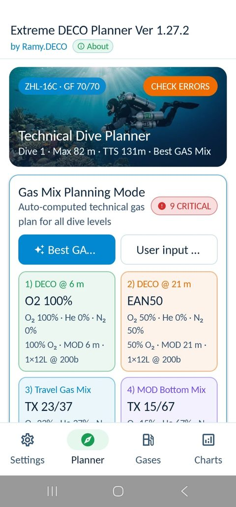
  
  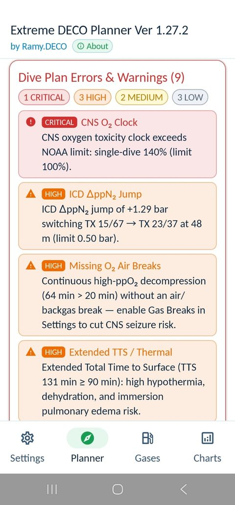
  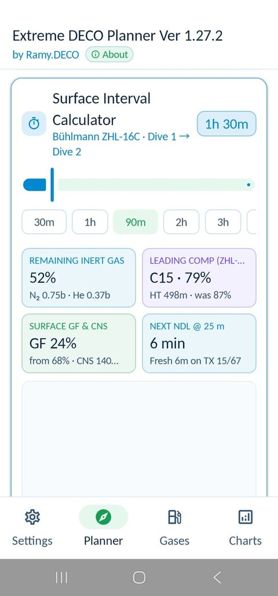
</p>

<p align="center">
  
  
  
  
  
  <a href="https://github.com/RamyRedaM/Extreme-DECO-Planner-Android-Mobile-APP/actions/workflows/build-apk.yml"></a>
</p>

---

> [!WARNING]
> **There is always a risk of decompression sickness (DCS), oxygen toxicity and other injury on any dive, even when you follow a plan produced by this app.** Every Experienced TEC diver knows very well that all the dive algos are trial/error algos and there is NO Mathematical Model on earth that can truely and 100% model the human body and how it will react to different depths with different gases , so Extreme DECO Planner is for training and planning only. It does not replace technical diver training, certification, a dive computer or your own judgement. Dive within your training limits, cross-check every plan with a second independent planner, and carry backup tables. You use this software entirely at your own risk.

---

## Table of Contents

- [Overview](#overview)
- [Download](#download)
- [Features](#features)
- [App Screens](#app-screens)
- [Screenshots](#screenshots)
- [How to Plan a Dive](#how-to-plan-a-dive)
- [Decompression Models](#decompression-models)
- [Best Gas Mix](#best-gas-mix)
- [Surface Interval Calculator](#surface-interval-calculator)
- [Safety Alerts](#safety-alerts)
- [Build from Source](#build-from-source)
- [Tech Stack](#tech-stack)
- [Project Structure](#project-structure)
- [Testing and Validation](#testing-and-validation)
- [Default Settings](#default-settings)
- [Known Limitations](#known-limitations)
- [Roadmap](#roadmap)
- [Contributing](#contributing)
- [References](#references)
- [Contact](#contact)
- [License](#license)

---

## Overview

Extreme DECO Planner helps technical divers plan open circuit and closed circuit (CCR) decompression dives on an Android phone. You set the depth, bottom time, gases and your limits, and the app:

1. Recommends the **best bottom, travel and deco gases** for the depth, with cylinder sizes.
2. Builds a full **decompression schedule** with the model you choose.
3. Reports **runtime, stops, CNS %, OTU, END, gas density and gas volumes**.
4. Draws **charts** of the profile, partial pressures, tissue loading and gas use.
5. Plans **multi-dive days**, carrying residual nitrogen and helium from dive to dive.
6. Generates **contingency plans** and a **CCR bailout** plan.
7. Exports the plan as a **PDF dive slate** or **CSV**, ready to share.

No account, no server and no internet connection are needed. Your settings and saved plans stay on your device.

---

## Download

**Latest test build: [Extreme-DECO-Planner-v1.27.2.apk](https://github.com/RamyRedaM/Extreme-DECO-Planner-Android-Mobile-APP/releases/download/v1.27.2/Extreme-DECO-Planner-v1.27.2.apk)** (about 18 MB, Android 7.0 or later)

All versions and release notes are on the [Releases page](https://github.com/RamyRedaM/Extreme-DECO-Planner-Android-Mobile-APP/releases). A Google Play release will follow later.

### How to install

1. Open the download link on your Android phone and download the APK.
2. Tap the downloaded file. When Android asks, allow **Install unknown apps** for your browser or file manager, then tap **Install**.
3. If Google Play Protect warns that the app is unknown, tap **Install anyway**. This is normal for apps installed outside Google Play.

> [!NOTE]
> This is a **test build** signed with a temporary debug key. A later build signed with a different key cannot install over it as an update: uninstall the old version first. Your saved plans are removed when you uninstall.

You can also [build the app from source](#build-from-source).

---

## Features

### Planning
- **Open Circuit** and **CCR** planning (setpoint-based), with automatic CCR bailout to open circuit
- **Multi-level dives** (add levels) and **multi-dive days** (add dives with surface intervals), with residual N2 / He carried across dives and a daily OTU total
- Two gas modes: **Best GAS Mix** (the app picks the gases) or **User input GAS** (you enter them)
- **Recreational (REC) mode, automatic:** in Best GAS Mix mode, a dive shallower than 40 m that stays within the no-decompression limit is planned as a recreational dive on Air or Nitrox (EAN32 by default), with no trimix and no deco gases. Deeper or longer dives switch to full technical planning.
- Travel, bottom, diluent, deco and bailout gas roles
- Automatic gas switching during the ascent
- Configurable descent, ascent, deco ascent and final ascent rates
- Last stop at 3 m or 6 m, detailed or compact (stops only) plan style
- Gas breaks on high-oxygen deco
- Water salinity: Fresh, EN13319, Salt, Red Sea (editable from 1020 to 1040 kg/m³) or custom density
- Dive site altitude, with an option for divers who arrived at altitude less than 12 hours ago
- Metric (m / L / bar / °C) or Imperial (ft / cuft / psi / °F) units

### Decompression
- **Bühlmann ZHL-16A, ZHL-16B and ZHL-16C** (ZHL-16C recommended)
- **Gradient Factors** (GF Low / GF High)
- Haldane loading at constant depth, Schreiner loading during ascents and descents
- **GF99** and **Surface GF** read-outs, no-decompression limit (NDL) and time to surface
- **VPM-B (experimental)** with conservatism 0 to 5. See [Known Limitations](#known-limitations).

### Gas management
- MOD, minimum (hypoxic) depth, END, EAD, PPN2 and gas density for every gas
- Gas consumption per segment from bottom and deco RMV
- Bottom gas reserve rules: Thirds, Quarters, Half, or Rock-Bottom (2× stress)
- Deco gas reserve rules: 1.5× required, or a real **lost-gas scenario** (the dive is replanned with each deco gas lost in turn, and every deco gas carries its worst-case need × the stress factor)
- Rock-bottom reserve for the bottom gas: two divers at stress breathing rate, from max depth to the first gas switch on the ascent
- Cylinder sizes and counts, auto-sized from your SAC rate in Best GAS Mix mode

### Surface intervals
- **Surface Interval Calculator** on the Planner tab, using Bühlmann ZHL-16C: remaining nitrogen and helium in all 16 tissue compartments, leading compartment, Surface GF, CNS decay, time to clear 90% of the excess gas, and the NDL for your next dive. See [Surface Interval Calculator](#surface-interval-calculator).

### Oxygen and safety
- CNS % from the NOAA oxygen limits, with surface decay between dives
- Pulmonary OTU per dive and per day
- **Safety alerts in four colour-coded levels:** CRITICAL (red), HIGH (orange), MEDIUM (yellow) and LOW (gray), covering more than 30 checks. See [Safety Alerts](#safety-alerts).
- A severity summary at the top of the alerts list, and a status pill that shows **PLAN READY** or the highest alert level

### Output
- Runtime table with depth, time, runtime, mix and ppO2
- Six charts: dive profile, gas partial pressures, tissue compartment bars, tissue tension timeline, gas consumption, and an M-value diagram
- **Export PDF Slate** (two-page dive slate and technical report) and **Export CSV Data**, saved to your phone or shared from the app
- Save named plans, and the app reopens with your last plan
- Dark and light themes
- Safety disclaimer that must be accepted on first launch

---

## App Screens

The app has four tabs:

| Tab | What you do there |
|---|---|
| **Settings** | Planning type, units, deco model, gradient factors, salinity, altitude, PPO2 and narcosis limits, ascent and descent rates, RMV, reserve rules, CCR setpoints, theme |
| **Planner** | Dive levels and dives in the day, Build Dive Profile, runtime table, summary (runtime, CNS, OTU, gas), colour-coded safety alerts, contingency plans, Surface Interval Calculator, PDF / CSV export, saved plans |
| **Gases** | Recommend Best Mix, or add and edit your own travel, bottom, diluent, deco and bailout gases with cylinders |
| **Charts** | Profile, partial pressures, tissue loading, gas consumption and M-value charts |

See the [Screenshots](#screenshots) section for every screen.

---

## Screenshots

### Planner

<table>
  <tr>
    <td align="center" valign="top"><br><sub>Technical dive plan with Best GAS Mix</sub></td>
    <td align="center" valign="top">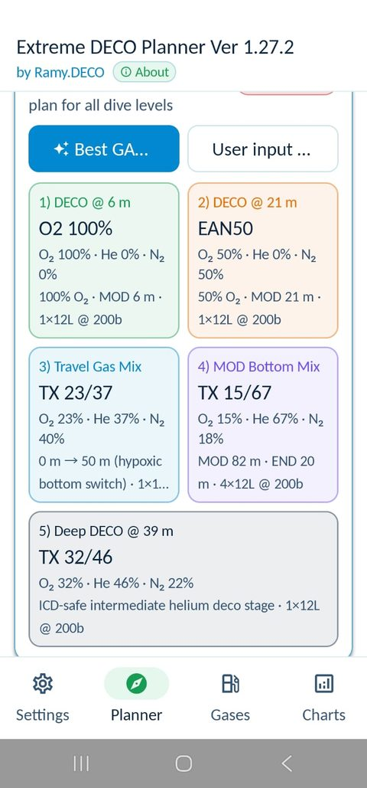<br><sub>Recommended gas and cylinder kit</sub></td>
    <td align="center" valign="top">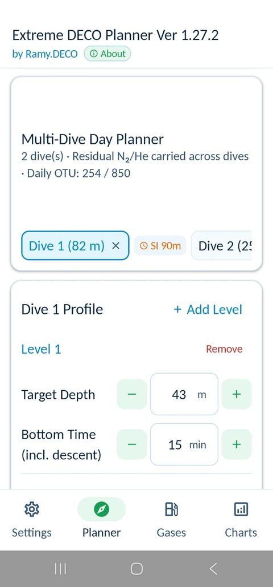<br><sub>Multi-dive day with surface intervals</sub></td>
  </tr>
  <tr>
    <td align="center" valign="top">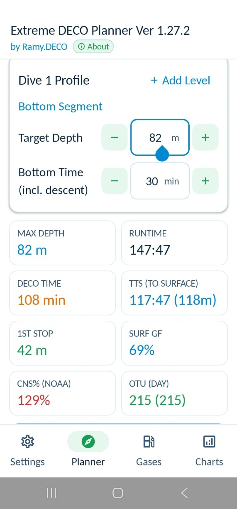<br><sub>Multi-level dive profile</sub></td>
    <td align="center" valign="top"><br><sub>Dive profile chart with gas switches and TTS</sub></td>
    <td align="center" valign="top"><br><sub>Surface Interval Calculator (ZHL-16C)</sub></td>
  </tr>
  <tr>
    <td align="center" valign="top"><br><sub>Safety alerts: CRITICAL and HIGH</sub></td>
    <td align="center" valign="top">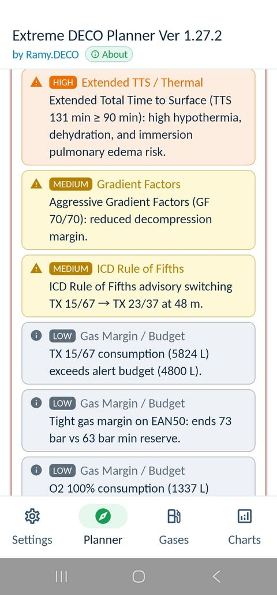<br><sub>Safety alerts: MEDIUM and LOW</sub></td>
  </tr>
</table>

### Gases

<table>
  <tr>
    <td align="center" valign="top">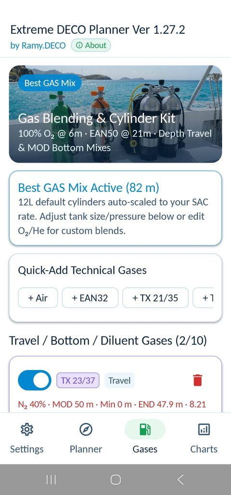<br><sub>Best GAS Mix cylinder kit</sub></td>
    <td align="center" valign="top">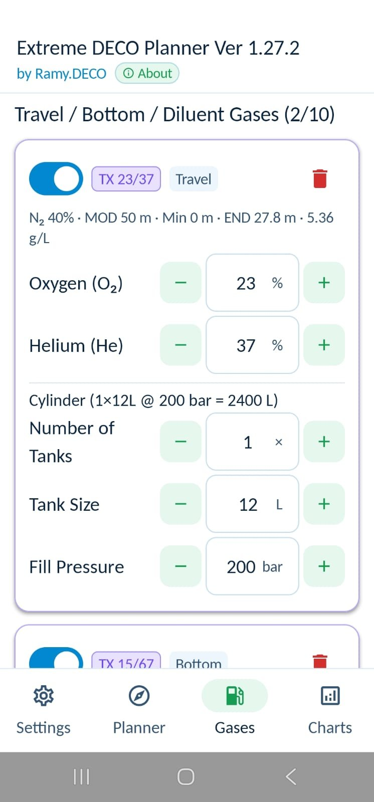<br><sub>Gas and cylinder editor with MOD, END and density</sub></td>
  </tr>
</table>

### Charts

<table>
  <tr>
    <td align="center" valign="top">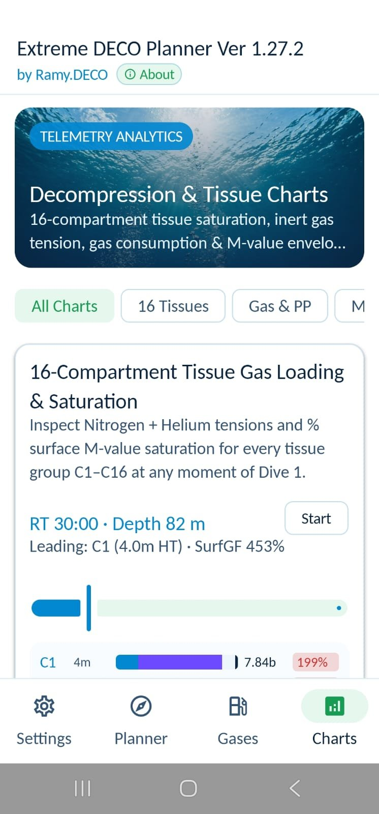<br><sub>Decompression and tissue charts</sub></td>
    <td align="center" valign="top">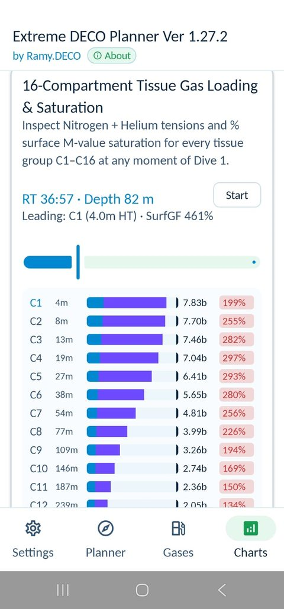<br><sub>16-compartment tissue loading</sub></td>
    <td align="center" valign="top">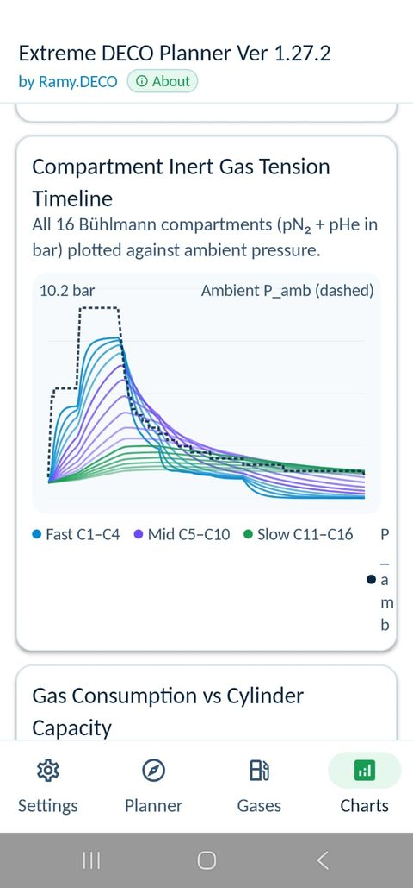<br><sub>Inert gas tension timeline</sub></td>
  </tr>
  <tr>
    <td align="center" valign="top"><br><sub>Gas consumption vs cylinder capacity</sub></td>
  </tr>
</table>

### Settings

<table>
  <tr>
    <td align="center" valign="top">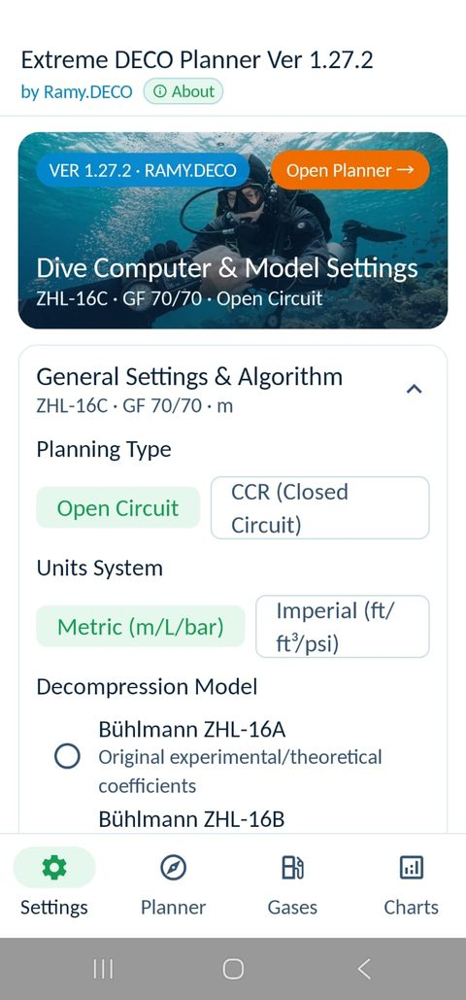<br><sub>Planning type and units</sub></td>
    <td align="center" valign="top">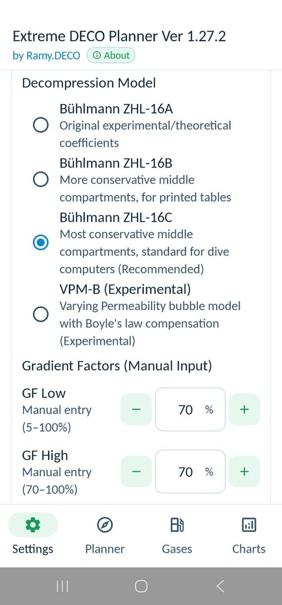<br><sub>Deco model and gradient factors</sub></td>
    <td align="center" valign="top">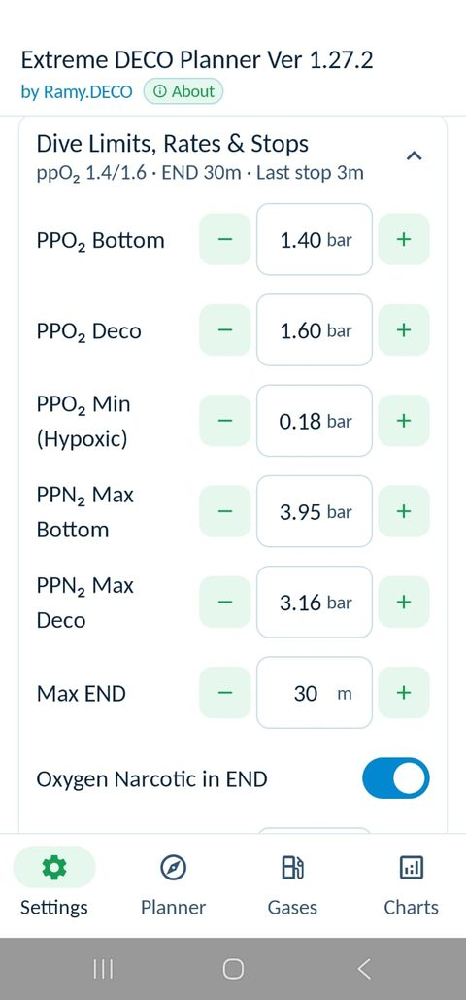<br><sub>ppO2, ppN2 and END limits</sub></td>
  </tr>
  <tr>
    <td align="center" valign="top">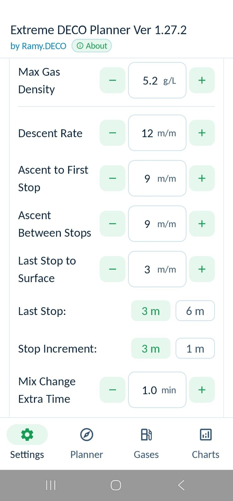<br><sub>Density, rates and stops</sub></td>
    <td align="center" valign="top">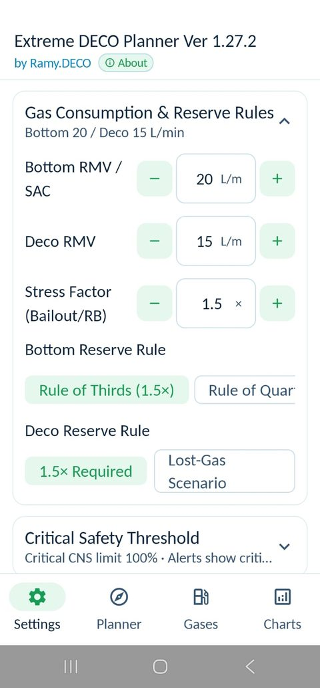<br><sub>Gas consumption and reserve rules</sub></td>
  </tr>
</table>

---

## How to Plan a Dive

1. **Settings:** choose Open Circuit or CCR, your units, the deco model (ZHL-16C recommended) and your gradient factors. Set the salinity and altitude of the dive site.
2. **Planner:** enter the maximum depth and bottom time. Add levels for a multi-level dive, or add dives for a dive day.
3. **Gases:** tap **Recommend Best Mix**, or enter your own gases and cylinders.
4. **Planner:** tap **Build Dive Profile**. Read the runtime table and summary, then work through the safety alerts: fix every **CRITICAL** (red) alert, and review **HIGH** (orange) and **MEDIUM** (yellow) ones.
5. **Repetitive dive?** Use the **Surface Interval Calculator** to see how much gas your tissues still hold and your NDL for the next dive, then tap **Apply** or **Add Dive 2** to carry the interval into the dive day.
6. **Charts:** check the profile, ppO2 and tissue loading.
7. **Export** the PDF slate, and cross-check the plan with a second planner before you dive.

### Example

40 m for 20 min on air, ZHL-16C, GF 20/80, salt water, deco on EAN50 and oxygen:

| Depth (m) | Stop (min) | Gas |
|---|---|---|
| 18 | 1 | EAN50 |
| 12 | 1 | EAN50 |
| 9 | 1 | EAN50 |
| 6 | 3 | Oxygen |
| 3 | 4 | Oxygen |

Total runtime about 35 minutes. Planners round stops and handle gas switches differently, so expect differences of about one minute per stop from other planners.

---

## Decompression Models

### Bühlmann ZHL-16

The model tracks nitrogen and helium in 16 tissue compartments, with half-times from 4 to 635 minutes for nitrogen and 1.51 to 240.03 minutes for helium.

| Variant | Use |
|---|---|
| ZHL-16A | Original experimental coefficients |
| ZHL-16B | More conservative middle compartments, designed for printed tables |
| ZHL-16C | Most conservative middle compartments, the standard for dive computers (recommended) |

The three variants differ only in the nitrogen `a` coefficients.

Tissue loading at constant depth (Haldane):

```
P(t) = P0 + (Pi − P0) × (1 − e^(−k·t)),   k = ln 2 / half-time
```

Tissue loading while changing depth (Schreiner):

```
P(t) = Pi0 + R·(t − 1/k) − (Pi0 − P0 − R/k) × e^(−k·t)
```

### Gradient Factors

Gradient Factors set how close each tissue may come to its Bühlmann M-value:

```
Tolerated ambient pressure = (P_tissue − a × GF) / (GF / b + 1 − GF)
```

- **GF Low** controls the first stop. Lower values give a deeper first stop.
- **GF High** controls surfacing. Lower values give longer shallow stops.
- GF moves in a straight line from GF Low at the first stop to GF High at the surface.
- GF 100/100 is pure Bühlmann.


---

## Best Gas Mix

In **Best GAS Mix** mode, for the planned depth the app:

1. Sets oxygen so ppO2 at maximum depth stays within your **PPO2 Bottom** limit.
2. Adds helium until the **END** is within your narcosis limit.
3. Adds more helium if the **gas density** is too high.
4. Adds a **travel gas** when the bottom mix is hypoxic at the surface.
5. Chooses **deco gases** for the depth (for example EAN50 and oxygen), with helium-based intermediate deco gases on deep dives, checked for ICD.
6. Sizes the **cylinders** from your SAC rate.
7. Avoids impractical fills: helium under 10% is dropped (plain nitrox) or raised to 10%.

| Metric | Meaning |
|---|---|
| MOD | Deepest depth where ppO2 stays within the limit |

On the Gases tab, each gas's END and density are shown where it is breathed: bottom gas at max depth, travel gas at its MOD (capped at max depth), deco gas at its switch depth.

| Minimum depth | Shallowest depth where the gas is not hypoxic |
| END | Equivalent narcotic depth |
| Density | Gas density at depth, in g/L |

---

## Surface Interval Calculator

Found on the **Planner** tab, below the contingency plans. It takes the tissue state at the end of the dive you are viewing and simulates off-gassing on the surface, breathing air, with the **Bühlmann ZHL-16C** model (whichever model you plan with).

**Inputs**
- Surface interval from 0 to 12 hours, with a slider and quick presets: 30 min, 1 h, 1.5 h, 2 h, 3 h, 4 h, 6 h and 12 h
- Next dive depth (9 to 60 m, in 3 m steps) and the gas for the next dive: by default the next dive's own planned gas (or EAN32 / Air when no next dive is planned), or pick Air or EAN32

**Results**

| Result | What it tells you |
|---|---|
| Remaining inert gas | Excess nitrogen and helium still in your tissues, as a % of what you surfaced with, plus peak N2 and He tensions |
| Leading compartment | The ZHL-16C compartment controlling your repetitive dive, its half-time and its load before and after the interval |
| Surface GF and CNS | Surface GF at surfacing and after the interval, and CNS % after the 90-minute half-time decay |
| Next dive NDL | No-decompression limit for the next dive with your residual gas, compared with a fresh diver |
| Time to clear | Estimated time until less than 10% of the excess inert gas remains (up to 24 h) |
| 16-compartment chart | Load of each compartment (C1 fast to C16 slow) at surfacing and after the interval |

**Actions:** **Apply to Dive N** sets this interval on the next dive in your dive day. **Add Dive 2** creates a new repetitive dive with this interval.

> [!NOTE]
> These figures are model estimates. The Bühlmann model was not designed to predict residual bubbles after a dive, so treat them as planning guidance and follow your dive computer and your training.

---

## Safety Alerts

Every plan is checked against more than 30 safety rules. Alerts are sorted from most to least severe, and each one says what was found and why it matters.

| Level | Colour | Meaning | What to do |
|---|---|---|---|
| **CRITICAL** | Red | The plan is unsafe, or a hard physiological limit is exceeded | Change the plan before diving |
| **HIGH** | Orange | A limit you set, or an accepted safe limit, is exceeded | Fix it, or accept it knowingly |
| **MEDIUM** | Yellow | Elevated risk or a reduced safety margin | Review it before diving |
| **LOW** | Gray | Advisory information | Be aware |

A plan with any CRITICAL alert is marked as having errors. The plan is still shown, so you can see what went wrong.

### What is checked

| Area | Checks and levels |
|---|---|
| **Oxygen (ppO2)** | Above 1.60 bar: CRITICAL. Above your PPO2 Bottom or PPO2 Deco limit: HIGH. Gas switch too close to its MOD: MEDIUM |
| **Hypoxia** | ppO2 below your PPO2 Min, or a hypoxic bottom mix with no travel gas that covers the surface: CRITICAL |
| **MOD** | Gas used deeper than its 1.60 bar MOD: CRITICAL. Deeper than the MOD for your own limit: HIGH |
| **Gas density** | Above 6.2 g/L: CRITICAL. Above your density limit (default 5.2 g/L): HIGH |
| **Narcosis (END / ppN2)** | END above 45 m: CRITICAL. Above 40 m: HIGH. Above your END limit: MEDIUM. Deco gas ppN2 above your PPN2 Max Deco: MEDIUM |
| **CNS oxygen clock** | Above 100% (or your error limit): CRITICAL. Above 80% (or your warning limit): HIGH. 50% or more: LOW |
| **OTU (lung oxygen dose)** | Above your per-dive limit, or more than 850 OTU in a day: HIGH. Daily total above your per-dive limit: MEDIUM |
| **Oxygen breaks** | More than 20 minutes of high-ppO2 deco without an air break: HIGH |
| **ICD (gas switches)** | ppN2 jump above your ICD limit: HIGH. Rule of Fifths broken: MEDIUM |
| **Surfacing** | Surface GF above 100%: CRITICAL. Above 90%: HIGH |
| **Gas supply** | Not enough gas for the plan plus reserve: CRITICAL. Surfacing pressure low: MEDIUM. Tight margin, or use above your alert budget: LOW |
| **Deco gas strategy** | Deco dive with no deco gas, or a deep dive with no mid-range deco gas: HIGH |
| **Rates** | Fast ascent (above 12 m/min to the first stop, or 9 m/min to the surface): MEDIUM. Fast descent (above 24 m/min): MEDIUM |
| **Deep helium (HPNS)** | 150 m or deeper: CRITICAL. 120 m or deeper with high helium or a fast descent: HIGH |
| **CCR** | Diluent above 1.60 bar ppO2 at depth, or no / too little bailout gas: CRITICAL. Diluent above 1.40 bar: HIGH |
| **Repetitive dives** | Surface interval under 30 min (or high carried-over CNS): HIGH. Under 60 min: MEDIUM. Reverse profile (deeper than the previous dive): HIGH or MEDIUM |
| **Profile shape** | Yo-yo (sawtooth) multi-level profile: MEDIUM. Planned time close to the NDL: MEDIUM. 6 m last stop on heavy deco: MEDIUM |
| **Exposure** | Time to surface of 90 min or more, or long deco in cold water: HIGH. Long dive or cold water (10 °C or less): MEDIUM |
| **Altitude** | Altitude dive with arrival under 12 hours ago: HIGH. Altitude dive (300 m or higher): MEDIUM |
| **Settings** | GF Low higher than GF High: CRITICAL. Aggressive GF (GF High above 90): MEDIUM. Very conservative GF: LOW. Helium lipid response flag: LOW |
| **Planning limits** | No breathable gas at some depth, or a deco obligation too large to plan: CRITICAL |

---

## Build from Source

### Requirements
- Android Studio (latest stable)
- JDK 17 or later (the project compiles to Java 11 bytecode)
- Android SDK 36 (min SDK 24, Android 7.0)

### Steps

1. Clone the repository:
   ```bash
   git clone https://github.com/RamyRedaM/Extreme-DECO-Planner-Android-Mobile-APP.git
   ```
2. Open the folder in Android Studio and let Gradle sync.
3. Select the **app** run configuration and run it on a device or emulator.

### Release builds

Release signing reads the keystore from environment variables. Set these before building a release:

| Variable | Purpose |
|---|---|
| `KEYSTORE_PATH` | Path to your upload keystore (default `my-upload-key.jks` in the project root) |
| `STORE_PASSWORD` | Keystore password |
| `KEY_PASSWORD` | Password of the `upload` key |

Never commit keystores or passwords to the repository.

### Automatic APK builds (GitHub Actions)

The workflow [`.github/workflows/build-apk.yml`](.github/workflows/build-apk.yml) builds the APK on GitHub's servers, with no local setup needed:

1. On GitHub, open **Actions › Build APK › Run workflow** (on the `main` branch).
2. The workflow runs all unit tests first. If any test fails, nothing is published. It then builds a debug-signed APK with JDK 21 and Gradle 9.3.1.
3. It publishes the APK as a pre-release named after `versionName`, for example `v1.27.2`, and also keeps it as a downloadable build artifact.

Before each new public build, raise `versionCode` and `versionName` in `app/build.gradle.kts`. Otherwise the new APK replaces the file in the existing release, and Android will not see it as an update.

---

## Tech Stack

| Layer | Choice |
|---|---|
| Language | Kotlin |
| UI | Jetpack Compose, Material 3 |
| Architecture | MVVM (ViewModel + StateFlow) |
| Storage | Jetpack DataStore (settings, last plan, saved plans) |
| Charts | Custom Compose Canvas charts |
| Export | Android `PdfDocument` for PDF, CSV text, FileProvider for sharing |
| Tests | JUnit 4, Robolectric |
| Build | Gradle (Kotlin DSL), version catalog |

The decompression engine in `engine/` is plain Kotlin with no Android or UI code, so it can be tested on its own.

---

## Project Structure

```
Extreme-DECO-Planner-Android-Mobile-APP/
├── app/
│   └── src/
│       ├── main/
│       │   ├── java/com/example/
│       │   │   ├── MainActivity.kt              App entry, tabs, disclaimer
│       │   │   ├── engine/                      Decompression and gas engine (pure Kotlin)
│       │   │   │   ├── Constants.kt             Physical constants, gas densities, NOAA limits
│       │   │   │   ├── Coefficients.kt          ZHL-16A / B / C tables, VPM-B parameters
│       │   │   │   ├── UnitsAndPressure.kt      Pressure, altitude, salinity, unit conversion
│       │   │   │   ├── TissuesAndBuhlmann.kt    Haldane, Schreiner, M-values, ceilings, GF, NDL, surface interval estimate
│       │   │   │   ├── GasCalculator.kt         MOD, END, EAD, density, Best Mix, ICD
│       │   │   │   ├── OxygenAndConsumption.kt  CNS, OTU, gas use, four-level safety alerts
│       │   │   │   ├── DivePlannerEngine.kt     Schedule builder, multi-dive day, contingencies, CCR bailout
│       │   │   │   └── Models.kt                Data classes and enums
│       │   │   ├── data/PlannerRepository.kt    DataStore persistence
│       │   │   ├── export/ExportManager.kt      PDF slate and CSV export
│       │   │   └── ui/
│       │   │       ├── screens/                 Settings, Planner, Gases, Charts
│       │   │       ├── components/              Charts, shared controls, Surface Interval Calculator card
│       │   │       ├── viewmodel/               PlannerViewModel
│       │   │       └── theme/                   Colours, typography, theme
│       │   ├── res/                             Icons, fonts, images, strings
│       │   └── AndroidManifest.xml
│       ├── test/                                Unit tests (engine)
│       └── androidTest/                         Instrumented tests
├── public/assets/aistudio/                      Build specification
├── gradle/libs.versions.toml                    Dependency versions
├── build.gradle.kts
└── settings.gradle.kts
```

---

## Testing and Validation

Run the unit tests from Android Studio: right-click `app/src/test` and choose **Run Tests**, or open the Gradle panel and run **app › Tasks › verification › test**.

`DecompressionEngineTest.kt` covers:

- Pressure and altitude, MOD, END and density
- Haldane, Schreiner and the Gradient Factor formula
- CNS and OTU
- **Golden schedules** for four reference dives (40 m air at GF 20/80 and 100/100, 60 m on 18/45 at GF 30/70, 30 m air without deco gas)
- Model conservatism (ZHL-16C at least as conservative as ZHL-16A) and GF monotonicity
- Residual nitrogen across a multi-dive day
- Best Gas Mix for every stage, and cylinder sizing from SAC rate
- Recreational mode (under 40 m within NDL: EAN32, no trimix, no deco gases)
- The four alert levels, including the CNS 80% single-dive warning and the new HIGH / MEDIUM checks
- The ZHL-16C Surface Interval Calculator
- One test per engine audit fix (CCR descent setpoint, next-dive gas, rock-bottom, lost-gas, travel gas display, Red Sea density, deco ppN2 alert, practical helium)

Before relying on any change to the engine, compare the results with an established planner such as Subsurface or MultiDeco.

---

## Default Settings

| Setting | Default |
|---|---|
| Deco model | ZHL-16C |
| Gas mode | Best GAS Mix |
| PPO2 bottom / deco / min | 1.40 / 1.60 / 0.18 bar |
| Water | Salt (1030 kg/m³) |
| Last stop | 3 m |
| Units | Metric |

All defaults can be changed in the **Settings** tab.

---

## Known Limitations

- **VPM-B is experimental and approximate.** It is not a full implementation of Baker's VPM-B algorithm. It reuses the ZHL-16C tissue model and makes the tolerated supersaturation stricter, scaled by the conservatism setting. Do not treat its schedules as true VPM-B schedules. Use the Bühlmann models for real dive planning.
- **Surface Interval Calculator results are estimates.** The time-to-clear figure and the residual loads come from the ZHL-16C model only. Always follow your dive computer for repetitive dives.
- Results can differ by about one minute per stop from other planners because of rounding and gas-switch handling.
- The app has not yet been independently validated. Always cross-check with a second planner.

---

## Roadmap

- [x] Test APK on GitHub Releases (v1.27.2)
- [ ] APK signed with a permanent release key
- [ ] Google Play release
- [ ] Full VPM-B implementation
- [x] Four-level safety alerts (CRITICAL / HIGH / MEDIUM / LOW)
- [x] Surface Interval Calculator (based on ZHL-16C)
- [x] Screenshots
- [ ] Short demo video
- [ ] pSCR (passive semi-closed rebreather) mode

---

## Contributing

Bug reports, test cases and independent validation of the engine are very welcome.

1. Open an [issue](../../issues) describing the bug or idea. For a planning bug, include the full settings and the schedule you expected.
2. Fork the repository and create a branch: `git checkout -b fix/my-change`
3. Add or update tests in `app/src/test` for any engine change.
4. Run the tests and open a pull request explaining what changed and how you validated it.

Any change that alters a decompression result must include before-and-after schedules and a comparison with at least one other planner.

---

## References

- A. A. Bühlmann, *Decompression: Decompression Sickness*, Springer
- Erik C. Baker, *Understanding M-values* and *Clearing Up the Confusion About "Deep Stops"*
- Erik C. Baker, *Oxygen Toxicity Calculations*
- NOAA Diving Manual, oxygen exposure limits
- Anthony and Mitchell, research on gas density limits in diving
- Subsurface, open-source dive log and planner (used for cross-checking)

---

## Contact

Built by **Ramy Reda**, an engineer who loves technical scuba diving.

For proposals and feedback: **RamyRedaM@gmail.com**, or open an issue on this repository.

---

## License

Copyright © 2026 Ramy Reda. All rights reserved.

The author accepts no liability for any injury or loss arising from the use of this software. See the warning at the top of this file.

---

<p align="center"><em>Plan the dive, dive the plan.</em></p>
